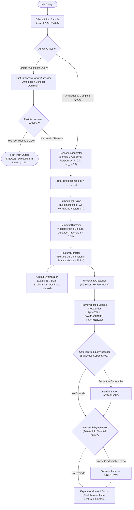
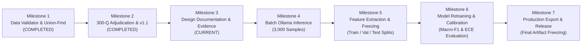

# Formal Project Design Document: LLM Uncertainty Classification Using Multi-Response Consistency and Feature-Based Machine Learning

**Document Version**: 1.0.0-RELEASE  
**Date**: November 17, 2026  
**Project**: LLM Uncertainty Classification Prototype  
**Repository**: `/Users/rahuljain/Documents/Rahul Jain/ML proj`  
**License**: CC BY-SA 3.0  
**Test Suite Status**: 81 / 81 Tests Passing (100%)  

---

## 1. Abstract & Project Motivation

Modern Large Language Models (LLMs) routinely exhibit high generation fluency while suffering from severe calibration failures. In open-domain question answering, LLMs frequently express unwarranted confidence when hallucinating factual answers, collapse distinct interpretations of polysemous queries into an arbitrary single response, and generate superficial answers or varied refusals to fundamentally inaccessible questions. Traditional token-level logit probabilities often fail to capture semantic uncertainty because high probability can be concentrated on semantically identical paraphrases, or conversely, dispersed across divergent phrasings of the same factual proposition.

This project designs, implements, and validates a scientifically grounded, leak-free machine learning architecture for multi-class epistemic uncertainty classification. Operating on a local instruction-tuned LLM (`qwen2.5:3b`) coupled with a sentence-transformer embedding model (`all-minilm`), our system samples stochastic responses ($N=10$), maps them into dense semantic spaces, performs agglomerative clustering to identify semantic equivalence classes, and extracts a canonical 16-feature vector capturing semantic entropy, cluster dispersion, lexical diversity, question-response overlap, hedging, and negation dynamics. An XGBoost classifier maps these feature vectors to an operational three-class epistemic uncertainty taxonomy: **`KNOWN`**, **`AMBIGUOUS`**, and **`UNKNOWN`**.

To guarantee computational efficiency and robust real-world behavior, the pipeline integrates an **Adaptive Fast-Path Router** with specialized heuristics:
1. A **Fast-Path Answerability Assessor** that executes low-latency single-response inference on elementary arithmetic and definitions without hardcoding labels.
2. A **Criterion Ambiguity Assessor** that decouples model response consensus from objective truth on subjective superlative queries.
3. An **Inaccessibility Safeguard** that prevents refusal variance on private credentials and unrecorded mental states from masquerading as multi-cluster ambiguity.

Furthermore, we design a 300-question evaluation benchmark with exact class balance (100/100/100) across seven distinct operational categories, governed by an indivisible **Union-Find Connected Component Partitioning** algorithm that prevents train/test data leakage even across multi-label adversarial pairs.

---

## 2. Problem Statement & Research Objectives

### 2.1 Problem Statement
Given a user query $q$, an LLM generator $\mathcal{G}$, and an embedding model $\mathcal{E}$, how can an automated system determine whether:
1. The question has a single determinate, verifiable answer in public knowledge that the system knows (**`KNOWN`**);
2. The question permits multiple materially different, equally legitimate interpretations, readings, or value judgments requiring clarification (**`AMBIGUOUS`**); or
3. The question is fundamentally unanswerable due to inaccessible private information, chaotic future contingencies, or false existential premises (**`UNKNOWN`**)?

### 2.2 Core Research Question
> *Can semantic consistency and information-theoretic representations extracted from stochastic multi-response local LLM generations reliably differentiate between answerable knowledge, question ambiguity, and fundamental unanswerability without relying on target label leakage or task-specific fine-tuning?*

### 2.3 Research Objectives
1. **Develop an Information-Theoretic Multi-Response Consistency Framework**: Formalize semantic entropy, agreement margins, and pairwise semantic similarity across dense sentence embeddings.
2. **Design a Strict 16-Feature Representation Free of Label Leakage**: Guarantee that feature extraction operates solely on question text and generated output strings, strictly prohibiting gold labels or target answers from entering the feature space.
3. **Construct an Adaptive, Cost-Effective Architecture**: Minimize latency and token expenditure by routing deterministic arithmetic and definition queries through a Fast Path ($N=1$) while reserving Multi-Response sampling ($N=10$) for complex, ambiguous, or uncertain queries.
4. **Establish Decoupled Epistemic Safeguards**: Prevent high model agreement from falsely asserting truth on subjective superlatives (*Agreement $\neq$ Truth*), and prevent stylistic refusal variation from misclassifying inaccessible secrets as ambiguous (*Refusal Dispersion $\neq$ Ambiguity*).
5. **Develop a Leak-Free Group-Partitioning Benchmark Protocol**: Build and audit a 300-question ground-truth benchmark and prove mathematically and empirically that connected-component group partitioning prevents train/validation/test leakage across composite paraphrases and adversarial boundary pairs.

---

## 3. Three-Class Epistemic Uncertainty Taxonomy

The system adopts a mutually exclusive, operationally testable three-class taxonomy grounded in epistemic logic and formal question-answering semantics:

| Uncertainty Class | Epistemic Definition | Operational Criteria | Model Generation Profile ($N=10$) | Representative Examples |
|---|---|---|---|---|
| **`KNOWN`** | Sufficiently specified query with a single, verifiable, authoritative answer in public knowledge. | Single factual answer exists across reputable references; prompt is unambiguous. | Single dominant cluster ($K=1$), high agreement ($p_1 \ge 0.80$), near-zero semantic entropy ($H \to 0$), low hedging. | *"What is 2 + 2?"*<br>*"What is the official capital city of France?"*<br>*"Define photosynthesis."* |
| **`AMBIGUOUS`** | Query with multiple materially different, equally plausible interpretations, referents, or subjective metrics. | Prompt lacks distinguishing scope (polysemy, unstated jurisdiction/timeframe, or unconstrained subjective superlatives). | Bimodal or trimodal clustering ($K \ge 2$), second cluster agreement $p_2 \ge 0.25$, low agreement margin $\Delta p < 0.50$, moderate-to-high entropy. | *"What is the capital of Georgia?"* (Tbilisi vs Atlanta)<br>*"Who is Jordan?"* (Michael vs Michael B.)<br>*"What is the best programming language?"* |
| **`UNKNOWN`** | Clear query for which empirical facts are fundamentally inaccessible, undetermined, or nonexistent. | Information is epistemically opaque: private credentials, chaotic future events, unrecorded history, or false existential presuppositions. | Broad cluster dispersion ($K \ge 4$), high normalized entropy ($H_{norm} \to 1.0$), low dominant agreement ($p_1 < 0.40$), or explicit refusal patterns. | *"What is the secret password in my safe?"*<br>*"What will Apple stock close at on Dec 31, 2035?"*<br>*"How many corners does a circle have?"* |

### Scientific Principles & Safeguards
1. **Ambiguity Is Not Ignorance ($\text{Ambiguity} \neq \text{Lack of Knowledge}$)**: An ambiguous query is not unanswerable; it possesses multiple legitimate answers depending on unstated context. Forcing a single answer is a calibration failure.
2. **Consensus Is Not Truth ($\text{Agreement} \neq \text{Truth}$)**: Strong agreement across stochastic samples reflects only the model's internal prior or training distribution default. It does not establish empirical truth on subjective superlatives.
3. **Refusal Dispersion Is Not Ambiguity ($\text{Refusal Dispersion} \neq \text{Ambiguity}$)**: Slight stylistic variations across multiple refusal responses (*"I cannot..."* vs *"As an AI..."*) must not be interpreted as competing interpretations.

---

## 4. Overall System Architecture

The system operates as an end-to-end adaptive pipeline integrating local inference, linguistic pre-processing, dense embedding, agglomerative clustering, feature calculation, heuristic assessment, and supervised gradient-boosted classification.



---

## 5. Adaptive Question-Answering Pipeline

The adaptive execution flow is implemented in [`experiments/ask.py`](file:///Users/rahuljain/Documents/Rahul%20Jain/ML%20proj/experiments/ask.py) and coordinated by [`src/classification/router.py`](file:///Users/rahuljain/Documents/Rahul%20Jain/ML%20proj/src/classification/router.py).

### 5.1 Step-by-Step Execution Lifecycle
1. **Initial Greedy Generation ($T=0.0$)**: The query is dispatched to `OllamaClient` using greedy decoding ($T=0$) to obtain a canonical reference response $r_1$.
2. **Adaptive Route Classification**: `AdaptiveRouter.route(question, initial_response)` evaluates question morphology and response properties:
   - Queries matching closed-domain arithmetic or standard definitional syntax (*"What is X?"*, *"Define Y"*) without uncertainty markers are routed to `FAST_PATH`.
   - Queries with detected polysemy, subjective superlatives, or hedging markers are routed to `MULTI_RESPONSE`.
3. **Fast-Path Verification**:
   - If routed to `FAST_PATH`, `FastPathAnswerabilityAssessor.assess` verifies whether the response directly answers the question or indicates inability to answer.
   - If verified, the pipeline extracts single-response baseline features ($H=0.0$, $p_1=1.0$, elapsed time $< 1.0\text{s}$) and returns immediately.
   - If uncertain or hedged, the query is dynamically escalated to `MULTI_RESPONSE`.
4. **Stochastic Multi-Response Sampling ($N=10$)**:
   - The generator draws 9 additional samples at $T=0.7$, $top\_p=0.9$, yielding exactly $N=10$ independent responses.
5. **Dense Semantic Embedding**:
   - `EmbeddingEngine` encodes all 10 responses into 384-dimensional dense vectors using `all-minilm` and applies $L_2$ normalization:
     $$\mathbf{v}_i = \frac{\mathcal{E}(r_i)}{\|\mathcal{E}(r_i)\|_2}$$
6. **Agglomerative Clustering**:
   - Pairwise cosine distances $d(r_i, r_j) = 1 - \mathbf{v}_i^\top \mathbf{v}_j$ are computed and clustered using average linkage at threshold $\tau = 0.20$ (similarity threshold $\ge 0.80$).
7. **Canonical 16-Feature Extraction**:
   - `FeatureExtractor` computes information-theoretic entropy, agreement margin, pairwise similarities, lexical ratios, question overlap, hedging, and negation count.
8. **Adaptive Answer Synthesis**:
   - If the second cluster agreement $p_2 \ge 0.25$, the pipeline formats a multi-interpretation answer showing both readings and their consensus proportions.
   - Otherwise, the medoid representative of the dominant cluster is returned.
9. **Supervised Inference & Safeguard Cascading**:
   - `UncertaintyClassifier` predicts probabilities across `KNOWN`, `AMBIGUOUS`, and `UNKNOWN`.
   - The prediction cascades through `CriterionAmbiguityAssessor` and `InaccessibilityAssessor` to correct known failure modes before output serialisation.

---

## 6. Multi-Response Consistency Methodology

Stochastic multi-response sampling exploits the property that an LLM's probability distribution over semantic spaces reflects its epistemic state:

1. **Epistemic Certainty (`KNOWN`)**: The model's probability mass is concentrated on a single semantic proposition. Sampling under non-zero temperature ($T=0.7$) introduces lexical and syntactic paraphrases, but their semantic representations remain tightly clustered around a single medoid.
2. **Polysemic Ambiguity (`AMBIGUOUS`)**: The prompt is compatible with multiple distinct, well-supported semantic propositions. The stochastic sampling process draws responses from multiple disjoint modes in probability space, forming distinct, balanced clusters.
3. **Epistemic Ignorance / Chaos (`UNKNOWN`)**: The model lacks grounding data. The stochastic responses either hallucinate disjoint conjectures, resulting in high cluster dispersion, or generate refusals that fail to provide factual answers.

---

## 7. Semantic Entropy & Clustering

### 7.1 Mathematical Formulations

#### 1. Cluster Probability Distribution
Given $N$ stochastic responses partitioned into $K$ disjoint semantic equivalence clusters $C_1, C_2, \dots, C_K$ with cardinalities $N_1 \ge N_2 \ge \dots \ge N_K > 0$ such that $\sum_{k=1}^K N_k = N$, the empirical probability of cluster $k$ is:
$$p_k = \frac{N_k}{N}$$

#### 2. Semantic Entropy ($H(X)$)
Semantic entropy measures the uncertainty over distinct semantic equivalence classes rather than surface tokens:
$$H(X) = - \sum_{k=1}^K p_k \ln(p_k)$$
- If all responses belong to a single cluster ($K=1$), $p_1 = 1.0$ and $H(X) = 0.0$.
- If every response forms its own distinct cluster ($K=N$), $p_k = \frac{1}{N}$ and $H(X) = \ln(N)$.

#### 3. Normalized Semantic Entropy ($H_{norm}(X)$)
To compare uncertainty across varying sample counts, entropy is normalized by the maximum possible entropy:
$$H_{norm}(X) = \begin{cases} \frac{H(X)}{\ln(N)} & \text{if } N > 1 \\ 0.0 & \text{if } N = 1 \end{cases}$$
Where $H_{norm}(X) \in [0.0, 1.0]$.

#### 4. Dominant & Second Agreement Margins
- **Dominant Cluster Agreement ($p_1$)**:
  $$p_1 = \max_{k} p_k = \frac{N_1}{N}$$
- **Second Cluster Agreement ($p_2$)**:
  $$p_2 = \begin{cases} \frac{N_2}{N} & \text{if } K \ge 2 \\ 0.0 & \text{if } K = 1 \end{cases}$$
- **Agreement Margin (First-Second Difference, FSD)**:
  $$\Delta p = p_1 - p_2$$
  A small margin $\Delta p \to 0$ with $p_2 \ge 0.25$ indicates competing plausible interpretations (hallmark of ambiguity).

#### 5. Pairwise Semantic Similarity
Given L2-normalized embedding vectors $\mathbf{v}_1, \dots, \mathbf{v}_N \in \mathbb{R}^D$ where $\mathbf{v}_i^\top \mathbf{v}_j = \cos(\theta_{ij})$:
$$\bar{S}_{mean} = \frac{2}{N(N-1)} \sum_{1 \le i < j \le N} \mathbf{v}_i^\top \mathbf{v}_j$$
$$S_{min} = \min_{1 \le i < j \le N} \mathbf{v}_i^\top \mathbf{v}_j$$

### 7.2 Medoid Representative Selection
For each cluster $C_k$, the representative response $r^*_k$ is the cluster medoid, defined as the response that maximizes average cosine similarity to all other responses within that cluster:
$$r^*_k = \arg\max_{r_i \in C_k} \sum_{r_j \in C_k} \mathbf{v}_i^\top \mathbf{v}_j$$

---

## 8. Complete 16-Feature Extraction Methodology

All 16 features are strictly extracted in [`src/features/feature_extractor.py`](file:///Users/rahuljain/Documents/Rahul%20Jain/ML%20proj/src/features/feature_extractor.py). No gold target labels or expected answers enter the extraction process, ensuring zero label leakage:

| Feature Index | Feature Name | Mathematical / Algorithmic Definition | Range | Epistemic Significance |
|:---:|---|---|:---:|---|
| 0 | `semantic_entropy` | $H(X) = - \sum_{k=1}^K p_k \ln(p_k)$ | $[0, \ln N]$ | Information-theoretic uncertainty across semantic clusters. |
| 1 | `normalized_entropy` | $H_{norm}(X) = H(X) / \ln(N)$ | $[0.0, 1.0]$ | Scale-invariant semantic entropy; $0 = \text{consensus}$, $1 = \text{dispersion}$. |
| 2 | `dominant_agreement` | $p_1 = N_1 / N$ | $[1/N, 1.0]$ | Proportion of samples supporting the most common interpretation. |
| 3 | `second_agreement` | $p_2 = N_2 / N$ (or $0.0$ if $K=1$) | $[0.0, 0.5]$ | Proportion supporting the second most common interpretation. |
| 4 | `agreement_margin` | $\Delta p = p_1 - p_2$ | $[0.0, 1.0]$ | Separation between primary and secondary interpretations. |
| 5 | `cluster_count` | $K = \| \{C_1, \dots, C_K\} \|$ | $[1, N]$ | Raw number of semantic equivalence classes formed. |
| 6 | `cluster_ratio` | $K / N$ | $[1/N, 1.0]$ | Density of semantic dispersion relative to sample count. |
| 7 | `mean_pairwise_similarity` | $\bar{S} = \frac{2}{N(N-1)} \sum_{i < j} \mathbf{v}_i^\top \mathbf{v}_j$ | $[-1.0, 1.0]$ | Global semantic cohesion across all generated samples. |
| 8 | `min_pairwise_similarity` | $S_{min} = \min_{i < j} \mathbf{v}_i^\top \mathbf{v}_j$ | $[-1.0, 1.0]$ | Semantic distance between the two most divergent responses. |
| 9 | `response_len_mean` | $\mu_L = \frac{1}{N} \sum_{i=1}^N \|r_i\|$ (character length) | $[0, \infty)$ | Verbosity metric; refusals and factual answers exhibit characteristic lengths. |
| 10 | `response_len_std` | $\sigma_L = \sqrt{\frac{1}{N} \sum_{i=1}^N (\|r_i\| - \mu_L)^2}$ | $[0, \infty)$ | Length stability; high variance indicates mixed response strategies. |
| 11 | `distinct_1gram_ratio` | $\| \text{Unique Unigrams} \| / \| \text{Total Unigrams} \|$ | $(0.0, 1.0]$ | Lexical diversity; high diversity correlates with unconstrained hallucination. |
| 12 | `distinct_2gram_ratio` | $\| \text{Unique Bigrams} \| / \| \text{Total Bigrams} \|$ | $(0.0, 1.0]$ | Syntactic diversity across response sequences. |
| 13 | `question_overlap_mean` | $\frac{1}{N} \sum_{i=1}^N \frac{\| T_q \cap T_{r_i} \|}{\| T_q \cup T_{r_i} \|}$ (token Jaccard) | $[0.0, 1.0]$ | Content overlap between question prompt and generated responses. |
| 14 | `hedging_score` | Mean occurrences of hedging regex patterns per response | $[0, \infty)$ | Epistemic modesty markers (*perhaps*, *maybe*, *depends on*). |
| 15 | `negation_count` | Mean occurrences of preserved negation tokens per response | $[0, \infty)$ | Detection of denials, contradictions, and explicit refusals. |

---

## 9. XGBoost Classification Architecture

The supervised uncertainty classifier is defined in [`src/classification/classifier.py`](file:///Users/rahuljain/Documents/Rahul%20Jain/ML%20proj/src/classification/classifier.py):

### 9.1 Underlying Model & Fallback Hierarchy
1. **Primary Model**: `xgboost.XGBClassifier` configured for multi-class classification:
   - Objective: `multi:softprob` (producing a calibrated probability distribution $[P(\text{KNOWN}), P(\text{AMBIGUOUS}), P(\text{UNKNOWN})]$).
   - Evaluation Metric: `mlogloss`.
   - Estimators: $n\_estimators = 100$.
   - Tree Depth: $max\_depth = 4$ (shallow trees prevent overfitting on small feature spaces).
   - Learning Rate: $\eta = 0.05$.
   - Random State: $42$ (enforcing deterministic training).
2. **Fallback Model**: If native XGBoost C-APIs or OpenMP runtimes are unavailable, the system transparently falls back to `sklearn.ensemble.HistGradientBoostingClassifier(max_iter=100, max_depth=4, learning_rate=0.05, random_state=42)`.

### 9.2 Label Encoding & Probability Output
The classifier maps between textual classes and numeric identifiers:
$$\text{KNOWN} \leftrightarrow 0, \quad \text{AMBIGUOUS} \leftrightarrow 1, \quad \text{UNKNOWN} \leftrightarrow 2$$
Predictions return a dictionary containing:
- `predicted_label`: String name of the argmax class.
- `confidence`: $\max_c P(y = c \mid \mathbf{x})$.
- `probabilities`: Complete mapping $\{c: P(y = c \mid \mathbf{x})\}$.
- `status`: `"PREDICTED"`.

---

## 10. Fast-Path Assessment

Implemented in [`src/classification/fast_path_assessor.py`](file:///Users/rahuljain/Documents/Rahul%20Jain/ML%20proj/src/classification/fast_path_assessor.py).

### 10.1 Motivation & Principles
Generating 10 stochastic responses for simple, closed-domain arithmetic (e.g. *"What is 2 + 2?"*) or standard textbook definitions introduces unnecessary latency ($> 5\text{s}$) and compute cost. However, a fast-path strategy must adhere to strict principles:
1. **Execution Strategy $\neq$ Hardcoded Label**: Routing a question to the fast path describes an execution optimization (generating 1 sample instead of 10); it must **not** automatically assign `KNOWN`.
2. **Distributional Invariance**: Passing $N=1$ features to an $N=10$ classifier violates distributional assumptions (e.g. $p_1=1.0, H=0.0, \sigma_L=0.0$ trivially on $N=1$).
3. **Escalation Protocol**: If the single initial response contains hedging, ambiguity triggers, or refusal phrases, the Fast Path assessor refuses to classify and escalates the query to `MULTI_RESPONSE`.

### 10.2 Assessment Rules
- **Arithmetic Queries**: Evaluated against strict regex arithmetic patterns. If the response contains a direct numeric solution without refusal, classified as `KNOWN` with confidence $0.98$ (`ASSESSED_FAST_PATH_DETERMINISTIC_ARITHMETIC`).
- **Concept Definitions**: Queries matching *"What is X?"* or *"Define X"*. If the response provides an unhedged, authoritative definition without polysemy triggers, classified as `KNOWN` with confidence $0.95$ (`ASSESSED_FAST_PATH_CONCEPT_DEFINITION`).
- **Direct Facts**: Concise factual queries receiving direct answers without hedging are classified as `KNOWN` with confidence $0.90$.

---

## 11. Criterion Ambiguity Assessment

Implemented in [`src/classification/ambiguity_assessor.py`](file:///Users/rahuljain/Documents/Rahul%20Jain/ML%20proj/src/classification/ambiguity_assessor.py).

### 11.1 The Decoupling Problem
When an LLM is asked a subjective question lacking evaluation criteria (e.g., *"What is the best programming language?"* or *"Who is the greatest athlete of all time?"*), the model's pre-training prior often causes it to repeatedly generate the same cultural default (e.g. Python, Michael Jordan). Consequently, multi-response clustering yields:
$$p_1 \ge 0.90, \quad H_{norm} \le 0.10, \quad \Delta p \ge 0.80$$
An unconstrained classifier interprets these metrics as high factual certainty and misclassifies the question as `KNOWN`.

### 11.2 The Criterion Ambiguity Assessor
`CriterionAmbiguityAssessor` decouples surface agreement from objective answerability:
1. **Superlative Morphological Detection**: Identifies unconstrained superlatives (*best*, *greatest*, *most beautiful*, *most successful*).
2. **Objective Criteria Check**: Verifies whether the prompt supplies an objective constraint (e.g. *"by population"*, *"by GDP"*, *"in 2020"*). If an objective metric is present, the superlative is determinate and the check passes.
3. **Response-Level Subjectivity Evidence**: Scans generated responses for phrases acknowledging subjectivity (*"no single best"*, *"depends on the criteria"*, *"subjective"*).
4. **Intervention**: If a subjective superlative lacks objective constraints and responses acknowledge subjectivity, the assessor overrides any spurious `KNOWN` prediction to **`AMBIGUOUS`** with heuristic confidence $0.95$.

---

## 12. Inaccessibility Safeguards

Implemented in [`src/classification/inaccessibility_assessor.py`](file:///Users/rahuljain/Documents/Rahul%20Jain/ML%20proj/src/classification/inaccessibility_assessor.py).

### 12.1 The Refusal Dispersion Failure Mode
When an LLM is queried about private credentials or inaccessible personal states (e.g., *"What is the secret password in my safe?"*), it cannot know the answer. Across 10 stochastic samples, it generates refusals with differing stylistic phrasing:
- Cluster 1 (Count 6): *"As an AI, I cannot access your personal safe password."*
- Cluster 2 (Count 4): *"I do not know your private safe combination."*

Because the embedding model maps these distinct phrasings into two separate clusters with counts 6 and 4:
$$p_1 = 0.60, \quad p_2 = 0.40, \quad \Delta p = 0.20$$
The trained XGBoost classifier recognizes this bimodal distribution as competing interpretations and misclassifies the query as `AMBIGUOUS`.

### 12.2 Dual-Condition Inaccessibility Safeguard
To fix this without breaking legitimate ambiguity classification:
1. **Question-Level Inaccessibility Pattern Matching**: Requires explicit question morphology targeting private credentials (*passwords, PINs, safe combinations, Wi-Fi keys*), unrecorded mental states (*"What was I thinking at 9 AM?"*), or private documents (*diaries, hidden notes*).
2. **Concept Definition Whitelist**: Explicitly excludes queries that define security concepts rather than requesting private values (e.g., *"What is a one-time password?"* or *"What does WPA2 mean?"* remain answerable definitions $\to$ `KNOWN`).
3. **Response-Level Refusal Verification**: Verifies that the majority of generated samples contain legitimate refusal or inability triggers (*"cannot determine"*, *"unknown"*, *"not recorded"*).
4. **Intervention**: When both question-level inaccessibility and response-level refusal are confirmed, the safeguard overrides spurious `AMBIGUOUS` predictions to **`UNKNOWN`** with confidence $0.95$.

---

## 13. Dataset & Benchmark Design

### 13.1 Benchmark Evolution: Pilot (60 Qs) to Candidate v1.1 (300 Qs)
The project began with a 60-question pilot dataset (`data/benchmarks/pilot_uncertainty_benchmark.jsonl`). To enable rigorous scientific evaluation, we designed, audited, and produced a 300-question ground-truth candidate benchmark (`data/benchmarks/uncertainty_benchmark_300_candidate_v1.1.jsonl`).

### 13.2 Category Quotas & Class Distribution (Exact 100/100/100 Balance)

```
300-Question Uncertainty Benchmark
├── KNOWN (100 Questions)
│   ├── Category 1: Determinate Factual Questions (Quota: 50)
│   └── Category 2: Established Concept Definitions (Quota: 50)
├── AMBIGUOUS (100 Questions)
│   ├── Category 3: Subjective Questions without Objective Metrics (Quota: 40)
│   └── Category 4: Genuine Entity Polysemy & Linguistic Ambiguity (Quota: 60)
└── UNKNOWN (100 Questions)
    ├── Category 5: Private or Inaccessible Information (Quota: 35)
    ├── Category 6: Unknowable Future Events (Quota: 35)
    └── Category 7: False Premises & Presupposition Failures (Quota: 30)
```

### 13.3 Audited Boundary Corrections & Audit Trail

| Record ID | Category | Previous Draft Question | Corrected Candidate v1.1 Question | Epistemic Justification |
|---|---|---|---|---|
| `draft_unk_fut_023`<br>`draft_unk_fut_024` | `unknowable_future_events` | *"What papal name will be chosen by the person elected as successor to Pope Francis?"* | *"As of November 2026, what papal name will be chosen by the person elected as the successor to Pope Leo XIV?"* | **Historical Shift**: Pope Francis was succeeded by Pope Leo XIV on May 8, 2025. Asking for Pope Francis's successor was historically settled (`KNOWN`). Shifted to successor to Pope Leo XIV with `2026-11` temporal anchor to preserve `UNKNOWN`. |
| `draft_unk_fut_027`<br>`draft_unk_fut_028` | `unknowable_future_events` | *"Which city will host the 2048 Summer Olympics?"* | *"As of November 2026, which city will host the Games of the XXXIX Olympiad (2048 Summer Olympics)?"* | **Temporal Grounding**: IOC host selection is unscheduled; added explicit `2026-11` anchor to prevent obsolescence upon future vote. |
| `draft_unk_false_013`<br>`draft_unk_false_014` | `false_premises` | *"How many sharp 90-degree corners does a perfect round circle have?"* | *"What is the interior angle measurement in degrees of each corner of a standard geometric round circle?"* | **Presupposition Loophole Fixed**: Original query allowed a literal, factual answer of "0" (`KNOWN`). Rephrased to query nonexistent vertex angle measurements (strictly impossible $\to$ `UNKNOWN`). |
| `draft_unk_false_021`<br>`draft_unk_false_022` | `false_premises` | *"How many miles of coastline does California share with the Atlantic Ocean?"* | *"What is the name of the commercial deepwater seaport in California that opens directly onto the Atlantic Ocean?"* | **Presupposition Loophole Fixed**: Original query allowed literal answer of "0 miles" (`KNOWN`). Rephrased to Atlantic seaport entity query (nonexistent $\to$ `UNKNOWN`). |
| `draft_known_fact_048` | `determinate_factual` | *"Who was the initial person to serve as President of the United States?"* | *"Under the United States Constitution, who was the initial person to serve as President of the United States?"* | **Historical Disambiguation**: Resolved ambiguity with John Hanson under the Articles of Confederation (1781–1789). |
| `draft_known_fact_029`<br>`draft_known_fact_030` | `determinate_factual` | *"What is the capital city of Japan?"* | *"What is the capital city of Japan?"* | **De Facto Statutory Note**: Rationale updated to document Tokyo as de facto seat of government under ISO 3166-1 despite absence of single codified statutory clause. |
| `draft_ambig_poly_055` | `genuine_ambiguity` | *"What is the capital of Columbia?"* | *"What is the capital of Columbia?"* | **Orthographic Homophone**: Retained as `AMBIGUOUS` explicitly evaluating homophone ambiguity between Columbia (SC/MO/DC) and Colombia (Bogota). |
| `draft_unk_priv_023` | `private_inaccessible_info` | *"What are the exact GPS coordinates of the final resting place of Alexander the Great's body?"* | *"What are the exact GPS coordinates of the final resting place of Alexander the Great's body?"* | **Lost Location**: Retained as `UNKNOWN` due to lost archaeological burial site, documenting the modern satellite coordinate framing. |

---

## 14. Union-Find Group Partitioning & Leakage Prevention

Implemented in [`src/evaluation/data_validator.py`](file:///Users/rahuljain/Documents/Rahul%20Jain/ML%20proj/src/evaluation/data_validator.py).

### 14.1 The Data Leakage Vulnerability
Standard train/test random splits allocate questions independently. If a dataset contains paraphrases (e.g. *"What is the capital of France?"* and *"Which city is France's capital?"*), one lands in train and the other in test, leading to inflated evaluation metrics. 

More critically, in **adversarial pairs** designed to test boundary conditions:
- `draft_known_fact_011`: *"What is the exact speed of light in a vacuum in meters per second?"* (`KNOWN`)
- `draft_unk_false_029`: *"What is the speed of sound through a complete vacuum in meters per second?"* (`UNKNOWN`)

If treated as separate groups, standard group-splitting puts one in training and one in testing. The classifier learns the lexical surface frame (*"... in a vacuum in meters per second?"*) during training and misapplies it during evaluation.

### 14.2 Union-Find Connected Component Algorithm
To guarantee mutual disjointness:
1. **Normalization**: Every record's question text is normalized by stripping punctuation, lowercasing, and collapsing whitespace.
2. **Disjoint-Set Union (Union-Find)**:
   - Identical normalized questions across records are unified into the same set:
     $$\text{Union}(\text{record}_i, \text{record}_j) \quad \text{if } \text{norm}(q_i) = \text{norm}(q_j)$$
   - Records sharing any declared group identifier (`group_id`, `question_group_id`, `group_key`) are unified:
     $$\text{Union}(\text{record}_i, \text{record}_j) \quad \text{if } \text{group\_ids}(r_i) \cap \text{group\_ids}(r_j) \neq \emptyset$$
3. **Component Closure**: The algorithm extracts connected components. Overlapping composite groups are transitively unified into indivisible atomic components.
4. **Cross-Label Adversarial Support**: Connected components may contain records with differing gold labels (e.g., `grp_adv_vacuum_wave_speed` contains 2 `KNOWN` and 2 `UNKNOWN` records). Group label homogeneity is not required.
5. **Strict Partition Invariant**:
   $$\text{Groups}(\text{Train}) \cap \text{Groups}(\text{Val}) = \emptyset, \quad \text{Groups}(\text{Train}) \cap \text{Groups}(\text{Test}) = \emptyset, \quad \text{Groups}(\text{Val}) \cap \text{Groups}(\text{Test}) = \emptyset$$

---

## 15. Training & Evaluation Methodology

### 15.1 Stratified Group Allocation
Partitioning allocates connected components across `train` (70%), `val` (15%), and `test` (15%) using greedy multi-label knapsack allocation to maintain exact class balance across partitions while preserving component indivisibility.

### 15.2 Comprehensive Evaluation Metrics
1. **Macro-Averaged F1 Score**:
   $$\text{Macro-F1} = \frac{1}{3} \sum_{c \in \{\text{KNOWN}, \text{AMBIGUOUS}, \text{UNKNOWN}\}} F1_c$$
2. **Per-Class Metrics**: Precision ($P_c$), Recall ($R_c$), and $F_1$-score ($F1_c$) for each class $c$.
3. **Full Contingency Confusion Matrix**: $3 \times 3$ matrix identifying inter-class misclassification patterns.
4. **Expected Calibration Error (ECE)** across $M=10$ confidence bins:
   $$\text{ECE} = \sum_{m=1}^{M} \frac{|B_m|}{N} \Big| \text{acc}(B_m) - \text{conf}(B_m) \Big|$$
5. **Brier Score**: Multi-class quadratic loss measuring probability calibration:
   $$\text{Brier} = \frac{1}{N} \sum_{i=1}^N \sum_{c=1}^3 (p_{ic} - y_{ic})^2$$

### 15.3 Evaluated Baselines & Ablations
- **Majority Baseline**: Always predicts the most frequent training class.
- **Pure Semantic Entropy Thresholding**: Simple heuristic thresholding on $H(X)$ without supervised feature learning.
- **Ablation Models**: Training the classifier while holding out subsets of features (e.g. linguistic features only, entropy features only, clustering features only) to isolate information contribution.

---

## 16. Existing Experimental Results & Documented Limitations

### 16.1 Verified Empirical Results

#### 1. Baseline Pilot Model & Dataset Lineage
- **Saved Model Weights**: [`models/uncertainty_classifier.joblib`](file:///Users/rahuljain/Documents/Rahul%20Jain/ML%20proj/models/uncertainty_classifier.joblib) (MD5: `b49b0704ad56af8602d218aaac59b3c3`, SHA-256: `e0adc459629d284ecd11d6f1dee0c3e9d437cddb34c1dde5d56979f589fce733`).
- **Feature Vector**: Exactly 16 canonical features.
- **Sample Count Reconciliation**:
  - **Seed Pilot**: $N=24$ questions ([`data/benchmarks/pilot_uncertainty_benchmark.jsonl`](file:///Users/rahuljain/Documents/Rahul%20Jain/ML%20proj/data/benchmarks/pilot_uncertainty_benchmark.jsonl)).
  - **Expanded Pilot Benchmark (v2)**: $N=60$ questions ([`data/benchmarks/uncertainty_benchmark_v2.jsonl`](file:///Users/rahuljain/Documents/Rahul%20Jain/ML%20proj/data/benchmarks/uncertainty_benchmark_v2.jsonl)).
  - **Extracted Feature Records**: $N=67$ feature vectors across 62 groups ([`data/features.jsonl`](file:///Users/rahuljain/Documents/Rahul%20Jain/ML%20proj/data/features.jsonl)), incorporating exploratory iterative re-runs.
  - **Saved Model Fit**: $N=44$ training instances recorded in [`models/uncertainty_classifier_metadata.json`](file:///Users/rahuljain/Documents/Rahul%20Jain/ML%20proj/models/uncertainty_classifier_metadata.json).
  - **Formal Group Split**: In [`experiments/results/training_report.json`](file:///Users/rahuljain/Documents/Rahul%20Jain/ML%20proj/experiments/results/training_report.json), the 67 records were partitioned into disjoint groups: **Train = 25**, **Val = 21**, **Test = 21**.
- **Held-Out Test Performance ($N_{\text{test}} = 21$)**:
  - **Accuracy**: $0.667$ (vs. $0.238$ majority baseline)
  - **Macro-F1**: $0.623$ (vs. $0.128$ majority baseline)
  - **Per-Class $F_1$**: `UNKNOWN` = **0.889** ($P=1.000, R=0.800$), `AMBIGUOUS` = **0.615** ($P=0.571, R=0.667$), `KNOWN` = **0.364** ($P=0.333, R=0.400$).

#### 2. Live Canonical Baseline (5 Questions) & Safeguard Boundary Verification (4 Queries) [9 Total Queries]
The end-to-end adaptive pipeline with inaccessibility safeguards was evaluated in two stages across 9 total queries: (1) the original 5 canonical baseline questions evaluating core routing and classification, and (2) 4 supplementary boundary queries specifically evaluating the inaccessibility safeguard against false-positive suppression:

| Question Prompt | Evaluation Phase | Expected Label | Pipeline Predicted Label | Execution Route | Assessment Mechanism | Outcome |
|---|:---:|:---:|:---:|:---:|---|:---:|
| *"What is 2 + 2?"* | Canonical Baseline | `KNOWN` | `KNOWN` | `FAST_PATH` | Deterministic arithmetic rule | **PASS** |
| *"What is the capital of France?"* | Canonical Baseline | `KNOWN` | `KNOWN` | `FAST_PATH` | Direct fact rule | **PASS** |
| *"What is the best programming language?"* | Canonical Baseline | `AMBIGUOUS` | `AMBIGUOUS` | `MULTI_RESPONSE` | Criterion Ambiguity Assessor | **PASS** |
| *"What is the secret password in my safe?"* | Canonical Baseline | `UNKNOWN` | `UNKNOWN` | `MULTI_RESPONSE` | Inaccessibility Safeguard | **PASS** |
| *"What was I thinking at exactly 9 AM yesterday?"* | Canonical Baseline | `UNKNOWN` | `UNKNOWN` | `MULTI_RESPONSE` | Inaccessibility Safeguard | **PASS** |
| *"What is a one-time password?"* | Boundary Safeguard | `KNOWN` | `KNOWN` | `FAST_PATH` | Concept definition (whitelist) | **PASS** |
| *"What does WPA2 mean?"* | Boundary Safeguard | `KNOWN` | `KNOWN` | `FAST_PATH` | Concept definition (whitelist) | **PASS** |
| *"What is the capital of Georgia?"* | Boundary Safeguard | `AMBIGUOUS` | `AMBIGUOUS` | `MULTI_RESPONSE` | Multi-response clustering ($p_2 \ge 0.25$) | **PASS** |
| *"What is the Wi-Fi password for my home router?"* | Boundary Safeguard | `UNKNOWN` | `UNKNOWN` | `MULTI_RESPONSE` | Inaccessibility Safeguard | **PASS** |

### 16.2 Documented Limitations
1. **Model Scale & Training Sample Size**: The active saved classifier artifact was trained on the 44-sample pilot split. Retraining on the 300-question benchmark has not yet been executed.
2. **Unverified Candidate Status of Benchmark**: The 300-question benchmark candidate v1.1 is structurally validated, quota-checked, and balanced, but remains in draft state (`annotation_status: "needs_human_review"`). Human annotator logging has not been finalized.
3. **Batch Generation Latency**: Generating 10 stochastic responses across 300 questions requires 3,000 local Ollama inference calls, which will take approximately 1.5 to 2.5 hours of continuous local compute.

---

## 17. Future Research Roadmap



### Next Implementation Milestones
1. **Milestone 3 (Current)**: Finalize formal project design document, evidence register, and documentation validation.
2. **Milestone 4**: Launch batch multi-response generation ($10 \times 300 = 3,000$ calls) using `OllamaClient` (`qwen2.5:3b`, $T=0.7$, $top\_p=0.9$) across candidate v1.1 with checkpointing.
3. **Milestone 5**: Run `FeatureExtractor` across all 300 response sets to generate the 300-row $\times$ 16-feature matrix. Partition into frozen train/val/test splits using `DatasetValidator.group_train_val_test_split(random_seed=42)`.
4. **Milestone 6**: Retrain `UncertaintyClassifier` on the frozen train partition, perform probability calibration (Platt scaling / Isotonic regression) on validation, and evaluate true held-out Macro-F1 on the read-only test set.
5. **Milestone 7**: Package final production weights, documentation PDF, and publishable research artifact.
