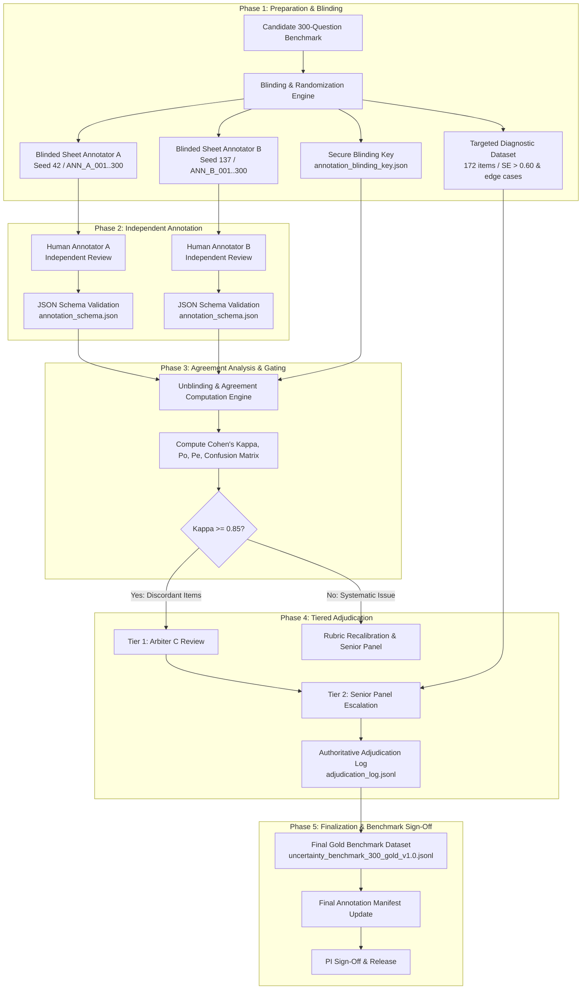

# End-to-End Human Annotation Workflow & Operational Lifecycle

**Project:** LLM Uncertainty Classification Using Multi-Response Consistency and Feature-Based Machine Learning  
**Target:** 300-Question Benchmark Gold-Label Validation (Milestone 7)  
**File:** `data/annotation/ANNOTATION_WORKFLOW.md`  

---

## 1. Executive Summary & Purpose

This document provides the definitive operational lifecycle for validating the ground-truth gold labels of the 300-question uncertainty benchmark (`data/benchmarks/uncertainty_benchmark_300_candidate_v1.1.jsonl`).

The workflow guarantees:
1. Complete double-blind independence of human annotators.
2. Comprehensive statistical verification of inter-annotator agreement (targeting Cohen's $\kappa \ge 0.85$).
3. Systematic multi-tiered adjudication of all disagreements and boundary queries.
4. Total preservation of baseline model artifacts, production feature sets, and existing benchmark files until formal adjudication sign-off.

---

## 2. Five-Phase Workflow Lifecycle

---

## 3. Phase-by-Phase Detailed Protocols

### Phase 1: Preparation & Blinding (Milestone 7 Deliverables)
- **Status:** **COMPLETE**
- **Artifacts:**
  - `blinded_annotation_annotator_a.jsonl`: 300 items randomized with Seed 42, IDs `ANN_A_001` to `ANN_A_300`.
  - `blinded_annotation_annotator_b.jsonl`: 300 items independently randomized with Seed 137, IDs `ANN_B_001` to `ANN_B_300`.
  - `annotation_blinding_key.json`: Cryptographic bidirectional mapping between blinded IDs and candidate question IDs.
  - `annotation_schema.json`: Strict JSON schema governing annotator submission records.
  - `targeted_diagnostic_review.jsonl`: 172 high-entropy, zero-entropy, and format-sensitive diagnostic queries.
  - `ANNOTATION_RUBRIC.md`, `ANNOTATOR_INSTRUCTIONS.md`, `AGREEMENT_ANALYSIS_PLAN.md`, `ADJUDICATION_PROTOCOL.md`.

---

### Phase 2: Independent Human Annotation
- **Execution Rules:**
  1. Annotator A and Annotator B receive only their respective blinded files and the Annotator Guide.
  2. Annotators work in isolation; no communication regarding question classifications is permitted.
  3. Annotators classify each item as `KNOWN`, `AMBIGUOUS`, or `UNKNOWN`, record confidence (`HIGH`, `MEDIUM`, `LOW`), provide a rationale, and flag `requires_adjudication = true` if borderline.
- **Completion Check:**
  Every submitted file must pass strict automated validation against `data/annotation/annotation_schema.json` with zero missing fields.

---

### Phase 3: Inter-Annotator Agreement & Statistical Gating
- **Procedure:**
  1. Run unblinding alignment script using `data/annotation/annotation_blinding_key.json`.
  2. Align $y_{A, i}$ and $y_{B, i}$ for all $i \in \{1, \dots, 300\}$.
  3. Calculate:
     - Raw agreement: $P_o = \frac{1}{N} \sum \mathbb{I}(y_A = y_B)$
     - Chance agreement: $P_e = \sum P(A=c)P(B=c)$
     - Cohen's Kappa: $\kappa = \frac{P_o - P_e}{1 - P_e}$
     - Full $3 \times 3$ confusion matrix and per-class F1 scores.
- **Gate Criteria:**
  - If $\kappa \ge 0.85$: Standard adjudication initiated for discordant items ($A \ne B$).
  - If $\kappa < 0.85$: Mandatory pause; inspect confusion clusters, review instructions, and conduct targeted re-annotation.

---

### Phase 4: Tiered Adjudication Protocol
- **Tier 1 (Arbiter C):**
  - All items with $y_A \ne y_B$ or `requires_adjudication = true` are extracted into an isolated file.
  - Arbiter C independently classifies without visibility into A's or B's choices.
  - 2-to-1 majority resolves standard disputes.
- **Tier 2 (Senior Panel):**
  - Three-way splits ($1\text{ KNOWN}, 1\text{ AMBIGUOUS}, 1\text{ UNKNOWN}$) and deep epistemic boundary questions escalate to the Senior Adjudication Panel.
  - Panel conducts evidentiary bibliographic review and writes a binding justification.
  - All decisions logged to `data/annotation/adjudication_log.jsonl`.

---

### Phase 5: Finalization & Benchmark Release
- **Compilation:**
  - Build verified final benchmark dataset: `data/benchmarks/uncertainty_benchmark_300_gold_v1.0.jsonl`.
  - Update `data/benchmarks/annotation_manifest_v1.1.json` to reflect final annotator counts, agreement metrics, and adjudication citations.
  - Compute cryptographic SHA-256 digests for all generated datasets.
- **Safeguards:**
  - Under no circumstances is the existing classifier retrained or tested against the benchmark until final gold labels are signed off and frozen.
