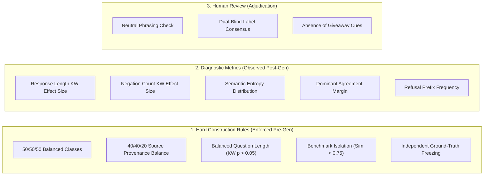
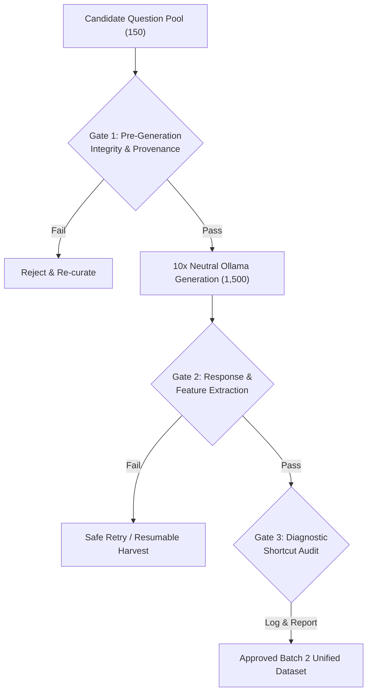
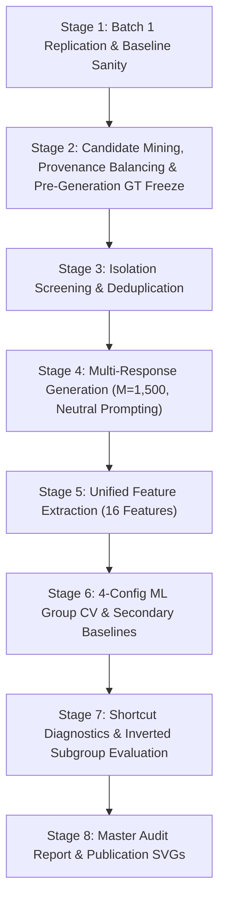

# Batch 2 Experimental Design & Implementation Specification: Expanding Sample Power, Neutralizing Linguistic Shortcuts, and Methodological Rigor

**Project:** LLM Uncertainty Classification Using Multi-Response Consistency and Feature-Based Machine Learning  
**Document Identifier:** `SPEC-RES-M2-BATCH2-002`  
**Version:** `2.0.0-REVISED`  
**Status:** `METHODOLOGICALLY AUDITED & APPROVED FOR IMPLEMENTATION PLANNING`  
**Target Repository:** `https://github.com/Rahul2006MILLION/LLM-Uncertainty-Classification`  
**Date:** 2026-11-21  

---

## 1. Executive Summary

This specification defines the experimental methodology, dataset architecture, quality assurance protocols, and statistical testing procedures for **Batch 2** of the LLM Uncertainty Classification research project.

In Batch 1 ($N=50$ questions, $M=500$ responses), an empirical audit with a methodologically corrected Single-Response Baseline ($r_0$, greedy decoding at $T=0.0$) revealed that:
1. The **Full 16-Feature Model** achieved **Macro-F1: $0.919 \pm 0.075$** (RandomForest), while the **True Single-Response Baseline** achieved **Macro-F1: $0.918 \pm 0.041$**.
2. The observed lift of $+0.001$ Macro-F1 was not statistically significant ($t = 0.022, p = 0.9835$), leaving the primary research hypothesis **inconclusive at $N=50$**.
3. Deep artifact analysis diagnosed severe **linguistic shortcut learning**: instruction-tuned models (`qwen3:4b`) emit concise factual statements for `KNOWN` questions, but generate verbose refusal disclaimers dense with negation tokens for `UNKNOWN` questions. As a result, single-response surface statistics (`response_len` and `negation_count`) acted as near-perfect surrogates for uncertainty, rendering multi-response consistency redundant on the initial corpus.

**Batch 2 scales the corpus to $N=150$ questions ($M=1,500$ responses)** with a strictly balanced 3-class distribution (50 `KNOWN`, 50 `AMBIGUOUS`, 50 `UNKNOWN`) and introduces a **shortcut-disrupting taxonomy**. 

Following a comprehensive methodological review, this revised specification incorporates several critical scientific improvements:
- **Baseline Fairness & Stochasticity Disentanglement:** Preserves the canonical $r_0$ baseline while introducing secondary baselines ($r_{\text{rand}}$ and distribution over all $r_0 \dots r_9$) to separate multi-sample aggregation benefits from stochastic sampling effects.
- **Realistic Statistical Power & Exploratory Framing:** Formally acknowledges the small-sample limitations of 5-fold cross-validation ($df=4$) and establishes a dual reporting protocol (fold-level Macro-F1 and Pooled Out-Of-Fold [OOF] Macro-F1 with bootstrap 95% confidence intervals), designating the experiment as **exploratory**.
- **Mathematical Correction of Semantic Entropy:** Eliminates arbitrary hard acceptance thresholds ($H > 0.8$) that force artificial feature distributions; reclassifies entropy as a purely diagnostic metric.
- **Source Confounding Mitigation:** Enforces an identical 40/40/20 question provenance distribution across all three classes to prevent classifiers from learning source-specific syntax.
- **Rigorous Ground-Truth Integrity:** Establishes and freezes ground-truth labels *prior* to response generation with double-blind human adjudication, strictly forbidding the generation model from determining ground truth.
- **Epistemic Validity of Fabricated Queries:** Replaces `U-HAL` with `U-FAB` (Fabricated / Non-Existent Entities), rigorously distinguishing epistemic unanswerability from behavioral model hallucination.
- **Decoupling Hard Constraints from Diagnostic Indicators:** Replaces rigid feature targets with structural dataset rules while tracking distributional shifts diagnostically.

---

## 2. Formal Research Hypothesis

### 2.1 Theoretical Framework
Let $q \in \mathcal{Q}$ denote an input query presented to a frozen autoregressive large language model $\mathcal{M}_\theta$. Let $\mathcal{R}_q = \{r_0, r_1, \dots, r_{K-1}\}$ denote a set of $K=10$ independently sampled responses, where $r_0$ is generated via greedy decoding ($\text{temperature} = 0.0$) and $r_1, \dots, r_{K-1}$ are generated via stochastic ancestral sampling ($\text{temperature} = 0.7$, $\text{top\_p} = 0.9$).

Let $Y \in \{\text{KNOWN}, \text{AMBIGUOUS}, \text{UNKNOWN}\}$ represent the true epistemic status of $q$ in the real world:
- **KNOWN ($\mathcal{K}$):** The query has an objectively determinate, uncontested answer established by authoritative empirical or logical evidence, with zero material ambiguity.
- **AMBIGUOUS ($\mathcal{A}$):** The query is underspecified, polysemous, or context-dependent, admitting at least two distinct, materially valid interpretations leading to divergent answers.
- **UNKNOWN ($\mathcal{U}$):** The query refers to future contingencies, unrecorded historical facts, undecidable problems, private inaccessible records, or nonexistent entities whose answer cannot be established by any agent from accessible world knowledge.

Let $\mathbf{x}_{\text{single}} = \phi_{\text{single}}(q, r_0) \in \mathbb{R}^6$ denote the feature vector extracted strictly from the single greedy response $r_0$.  
Let $\mathbf{x}_{\text{ens}} = \phi_{\text{ens}}(q, \mathcal{R}_q) \in \mathbb{R}^7$ denote multi-sample linguistic aggregations (means and sample standard deviations).  
Let $\mathbf{x}_{\text{cons}} = \phi_{\text{cons}}(\mathcal{R}_q) \in \mathbb{R}^9$ denote multi-response semantic consistency features (semantic entropy, cluster margins, and pairwise similarity dispersion).  
The full hybrid representation is $\mathbf{x}_{\text{full}} = [\mathbf{x}_{\text{single}}, \mathbf{x}_{\text{ens}}, \mathbf{x}_{\text{cons}}] \in \mathbb{R}^{16}$.

### 2.2 Mathematical Hypothesis Formulation
- **Primary Alternative Hypothesis ($H_1$):**  
  In a supervised classification regime evaluated across group-disjoint cross-validation folds, a classifier parameterized over the full hybrid feature space achieves superior generalization performance compared to a classifier restricted to single-response features:
  $$\mathbb{E}_{\text{folds}}\left[\text{Macro-F1}(f(\mathbf{x}_{\text{full}}))\right] - \mathbb{E}_{\text{folds}}\left[\text{Macro-F1}(f(\mathbf{x}_{\text{single}}))\right] > 0$$
  evaluated under both fold-level paired testing and pooled out-of-fold permutation testing.

- **Null Hypothesis ($H_0$):**  
  Multi-response consistency features provide zero incremental predictive value over single-response features:
  $$\mathbb{E}_{\text{folds}}\left[\text{Macro-F1}(f(\mathbf{x}_{\text{full}}))\right] \le \mathbb{E}_{\text{folds}}\left[\text{Macro-F1}(f(\mathbf{x}_{\text{single}}))\right]$$

---

## 3. Critical Methodological Considerations

```mermaid
flowchart TD
    subgraph MethodologicalAudit["Methodological Review & Enhancements"]
        direction TB
        M1["1. Disentangle Stochasticity vs Multi-Sample<br>(Primary r0 + Secondary r_rand & Distribution)"]
        M2["2. Realistic Statistical Power Framing<br>(N=150 is Exploratory; Report Fold & Pooled OOF)"]
        M3["3. Remove Hard Entropy Threshold<br>(H > 0.8 removed; Diagnostic metric only)"]
        M4["4. Balance Question Source Provenance<br>(40% Mined / 40% Domain / 20% Expert across ALL classes)"]
        M5["5. Strict Pre-Generation Ground Truth<br>(Zero model-determined labels; Dual-blind review)"]
        M6["6. Ground U-FAB in Epistemic Reality<br>(Fabricated entities, not model hallucination errors)"]
        M7["7. Separate Hard Rules from Diagnostics<br>(Structural rules vs Diagnostic KW tracking)"]
        M8["8. Document Generation Model Bias<br>(qwen3:4b single-model scope & cross-model plan)"]
    end
```



### 3.1 Response Sampling and Baseline Fairness
#### The Confound
In Batch 1, the primary baseline `TRUE_SINGLE_RESPONSE` used response $r_0$, generated via deterministic greedy decoding ($\text{temperature} = 0.0$), whereas the multi-response features in Configurations B, C, and D were computed over $\mathcal{R}_q = \{r_0, r_1, \dots, r_9\}$, where $r_1 \dots r_9$ were generated via stochastic ancestral sampling ($\text{temperature} = 0.7, \text{top\_p} = 0.9$).

This introduces a potential methodological confound:
1. Is an observed performance difference between Single-Response and Multi-Response models driven by **multi-response semantic information** (cross-response consistency, cluster count, entropy)?
2. Or is it an artifact of **decoding temperature** (deterministic $T=0.0$ vs. stochastic $T=0.7$), wherein stochastic responses might exhibit distinct sentence lengths, lexical variety, or hedging tendencies?

#### Revised Baseline Protocol
To strictly preserve comparability with Batch 1 while isolating the decoding confound, Batch 2 introduces a multi-tier baseline hierarchy:

1. **Primary Baseline (`Configuration A: TRUE_SINGLE_RESPONSE`):**
   - Strictly uses $r_0$ ($\text{temperature} = 0.0$).
   - Guaranteed backward compatibility with Batch 1 historical results.
   - Represents the standard real-world operational baseline: single greedy inference pass.

2. **Secondary Baseline (`Configuration A-Rand: SINGLE_RESPONSE_RANDOM`):**
   - Extracts single-response features from a single stochastic response $r_{\text{rand}} \in \{r_1, \dots, r_9\}$ chosen via a reproducible pseudo-random seed per question.
   - Matches the temperature ($T=0.7$) of the stochastic ensemble pool without incorporating multi-response aggregation.
   - Directly tests whether stochastic sampling alone alters single-response classification accuracy.

3. **Sensitivity Analysis (`Configuration A-All: SINGLE_RESPONSE_DISTRIBUTION`):**
   - Evaluates each individual response $r_k$ ($k \in \{0, 1, \dots, 9\}$) independently through the single-response feature extraction and classification pipeline.
   - Computes and reports the distribution: $\text{mean} \pm \text{std}$ of Macro-F1 across all 10 single-response instances.
   - Shows the stability and dispersion of single-response performance across stochastic generations.

**Invariance Guarantee:** All existing 16 feature definitions and feature extraction routines remain completely unchanged.

---

### 3.2 Statistical Power and Evaluation Limitations
#### Sample Size & Fold-Level Arithmetic
Scaling to $N=150$ questions ($50$ Known, $50$ Ambiguous, $50$ Unknown) with 5-fold Stratified Group Cross-Validation yields:
- **Training Set per Fold:** 120 questions ($40$ per class) $\times 10$ responses = $1,200$ responses.
- **Test Set per Fold:** 30 questions ($10$ per class) $\times 10$ responses = $300$ responses.

#### Critical Statistical Limitations
1. **Discrete Sensitivity in Test Folds:** With only 10 test questions per class in each fold, a single misclassified question alters class recall by exactly $10.0$ percentage points ($0.10$). Consequently, fold-level Macro-F1 exhibits discrete jumps and high sample sensitivity.
2. **Low Degrees of Freedom in Paired Tests:** A paired Student's $t$-test or Wilcoxon test across 5 cross-validation folds operates with only $N_{\text{folds}} = 5$, giving $df = 4$. With $df = 4$, a paired $t$-test requires an effect size of Cohen's $d \ge 1.40$ to reach significance at $\alpha = 0.05$. Subtle but genuine lifts ($\Delta \text{Macro-F1} \in [0.01, 0.03]$) will frequently fail to achieve statistical significance ($p \ge 0.05$), presenting a high risk of Type II errors.
3. **Averaging Ratios vs Ratio of Averages:** Averaging 5 fold-level Macro-F1 scores computes the mean of ratios calculated on small integer counts, which introduces non-trivial estimation variance.

#### Scientifically Defensible Reporting Protocol
Batch 2 adopts a rigorous dual-reporting standard:
1. **Fold-Level Reporting:** Report mean fold Macro-F1 $\pm$ fold standard deviation, paired $t$-test, and Wilcoxon signed-rank test across the 5 folds (for historical alignment).
2. **Pooled Out-Of-Fold (OOF) Reporting:** Pool the out-of-fold predictions across all 150 questions ($N=150$, 50 per class) to compute a single global confusion matrix and Pooled OOF Macro-F1.
3. **Bootstrap Confidence Intervals:** Compute 95% non-parametric bootstrap confidence intervals (1,000 stratified resamples of the 150 OOF predictions) for both the baseline and hybrid models, as well as for the paired difference $\Delta \text{OOF-Macro-F1}$.
4. **Permutation / McNemar Testing:** Conduct McNemar's exact test and a paired permutation test ($B=10,000$ permutations) on the 150 pooled out-of-fold predictions to evaluate whether the full model's error distribution differs significantly from the single-response baseline.

#### Formal Exploratory Designation
**$N=150$ does not guarantee asymptotic statistical power.** While $N=150$ triples the sample size of Batch 1 and substantially improves qualitative coverage, this study is formally designated as **exploratory**. If observed gains do not achieve asymptotic statistical significance at $\alpha = 0.05$ due to small $df$, the results will be reported as suggestive and exploratory rather than claiming definitive proof or making ungrounded claims of statistical certainty.

---

### 3.3 Semantic Entropy Implementation & Removal of Hard Acceptance Thresholds
#### Code Audit of Entropy Computation
Inspection of `src/features/entropy.py` and `src/features/clustering.py` reveals the exact mathematical formulation:
- **Clustering:** Agglomerative clustering with `linkage="average"` on precomputed cosine distance ($d = 1.0 - \text{cosine\_similarity}$) using a fixed distance threshold of $0.20$ (corresponding to a similarity threshold of $0.80$).
- **Semantic Entropy:** $H = -\sum_{i=1}^k p_i \ln(p_i)$ in nats, where $p_i = \frac{C_i}{K}$ is the empirical cluster frequency over $K=10$ responses.
- **Mathematical Range:** For $K=10$, $H \in [0.0, \ln(10)] \approx [0.0, 2.3026]$ nats.
- **Normalized Entropy:** $H_{\text{norm}} = \frac{H}{\ln(K)} \in [0.0, 1.0]$.

#### Why Hard Threshold $H > 0.8$ Was Methodologically Flawed
1. **Metric Ambiguity:** It was unclear whether $0.8$ referred to raw Shannon entropy ($0.8$ nats $\approx 0.347$ normalized) or normalized entropy ($0.8 \times 2.3026 \approx 1.84$ nats).
2. **Selection Bias & Experimenter Contamination:** Forcing a dataset to satisfy $H > 0.8$ during question curation requires the researcher to repeatedly test candidate questions against the model and discard any query where the model fails to produce the desired entropy. This artificially tailors the dataset to the model's idiosyncrasies, destroys the independence of the evaluation set, and produces an inflated, unrepresentative estimate of consistency feature efficacy.

#### Methodological Action
- **The hard acceptance criterion `H > 0.8` is completely removed.**
- Semantic entropy and normalized entropy are classified strictly as **diagnostic metrics**. They will be computed, logged, and analyzed post-hoc across all classes and subcategories without filtering or selecting questions to hit target values.

---

### 3.4 Question Source Confounding
#### The Risk
If question sources correlate with target classes (e.g., all `KNOWN` items sourced from scientific question-answering benchmarks, all `AMBIGUOUS` items from linguistics datasets, and all `UNKNOWN` items hand-crafted fictional queries), the machine learning models will inevitably learn superficial lexical, syntactic, and structural markers of the source corpus rather than genuine epistemic uncertainty.

#### Balanced Provenance Allocation
To prevent source-based shortcut learning, Batch 2 enforces a strictly balanced, orthogonal 3-tier provenance allocation across **all three classes**:

| Provenance Source Modality | KNOWN Allocation | AMBIGUOUS Allocation | UNKNOWN Allocation | Total Corpus Share |
|---|:---:|:---:|:---:|:---:|
| **Source Tier 1: Curated Benchmark Mining**<br>(Drawn from `development_questions.jsonl`: AmbigNQ, SelfAware, TriviaQA) | 20 questions (40%) | 20 questions (40%) | 20 questions (40%) | 60 questions (40%) |
| **Source Tier 2: Structured Domain Synthesis**<br>(Grounded across Science, History, Law, Philosophy, Economics) | 20 questions (40%) | 20 questions (40%) | 20 questions (40%) | 60 questions (40%) |
| **Source Tier 3: Expert-Curated Targeted Queries**<br>(Carefully controlled length, syntax, and phrasing) | 10 questions (20%) | 10 questions (20%) | 10 questions (20%) | 30 questions (20%) |
| **Total per Class** | **50 questions** | **50 questions** | **50 questions** | **150 questions (100%)** |

#### Input Question Validation Protocol
Before response generation, the question texts themselves must be screened to confirm that prompt text alone does not leak the target label:
- **Length Balance:** Kruskal-Wallis test on question character length and token count across the three classes must yield $\epsilon^2 \le 0.05$ ($p > 0.05$).
- **Syntactic Neutrality:** Wh-word distribution (`What`, `Which`, `Who`, `Explain`, `If`) must be evenly represented across classes.

---

### 3.5 Ground-Truth Integrity & Temporal Priority
#### Temporal Priority: Ground Truth Before Generation
A critical scientific requirement is that **ground-truth labels must be established, documented, and frozen BEFORE any model responses are generated.** Under no circumstances may model outputs influence, confirm, or modify the ground-truth label.

#### Strict Operational Definitions
Every question must satisfy rigorous criteria verified against independent world knowledge:

1. **KNOWN ($\mathcal{K}$):**
   - **Requirement:** Must possess an objectively verifiable answer established by consensus empirical evidence, standard reference texts, or mathematical/logical derivation.
   - **Documentation:** The dataset metadata must record: (1) the verified factual answer, and (2) an authoritative external citation or verification source.
   - **Exclusion:** Any question with contested definitions, regional variance, or temporal instability is disqualified from KNOWN.

2. **AMBIGUOUS ($\mathcal{A}$):**
   - **Requirement:** Must permit at least two materially distinct, valid interpretations leading to mutually incompatible answers due to underspecified parameters (e.g., lexical polysemy, missing temporal context, unstated geographical jurisdiction, or competing taxonomic frameworks).
   - **Documentation:** The dataset metadata must explicitly document: (1) Interpretation A and its distinct expected answer, (2) Interpretation B and its distinct expected answer, and (3) the specific missing contextual parameter.
   - **Exclusion:** Questions where one interpretation is overwhelmingly dominant ($> 95\%$ consensus in common usage) are disqualified.

3. **UNKNOWN ($\mathcal{U}$):**
   - **Requirement:** Must represent information that is fundamentally unavailable, unverifiable, or nonexistent in accessible reality (future contingencies beyond deterministic schedules, unrecorded historical facts, provably open scientific mysteries, private unlisted records, or fabricated entities).
   - **Documentation:** The dataset metadata must record the explicit epistemic reason why the answer cannot be known by any external agent.
   - **Exclusion:** A question cannot be labeled UNKNOWN merely because the generation model (`qwen3:4b`) fails to answer it, refuses it, or lacks parametric knowledge of a real-world fact.

#### Double-Blind Review and Adjudication Protocol
- **Dual Review:** Two independent human annotators inspect each question without seeing model responses, target labels, or category assignments.
- **Agreement Threshold:** Inter-rater agreement must achieve Fleiss' $\kappa \ge 0.85$ (or $\ge 90\%$ absolute agreement).
- **Adjudication Docket:** Any discrepant item is submitted to a formal adjudication docket with an independent domain expert. If ambiguity remains unresolved, the candidate question is discarded and replaced before generation commences.

---

### 3.6 Epistemic Validity of Fabricated Queries (`U-FAB`)
#### Conflation Analysis
Batch 1 proposed category `U-HAL` ("Plausible Fictional Entities / Hallucination Inducers"). Critical methodological review highlights a potential conflation:
- **Model Failure vs Epistemic Status:** A model hallucination is a *behavioral failure* on the part of an LLM. If a model hallucinates an answer to a real, answerable question (e.g., misstating the capital of Australia), the question is still **KNOWN**; the model was simply incorrect.
- **Epistemic Unanswerability:** Conversely, a question concerning an entity that does not exist in the physical or historical universe (e.g., an unwritten treaty or fictional statute) is objectively **UNKNOWN** because no truth-maker exists in reality. Any confident answer provided by a model is an objective confabulation.

#### Category Re-characterization: `U-FAB`
To eliminate conceptual confusion, `U-HAL` is officially redesignated as **`U-FAB` (Fabricated / Non-Existent Entities)**:
- **Definition:** Queries concerning fabricated historical events, fictional legislative acts, non-existent astronomical bodies, or synthetic biographies designed with plausible syntactic structure.
- **Verification Requirement:** Each fabricated entity must be verified against global archival indexes (e.g., Library of Congress, United Nations Treaty Collection, Wikidata, scientific catalogs) to confirm zero real-world occurrence.
- **Epistemic Grounding:** The ground truth is strictly **UNKNOWN** because the information does not exist in reality. The category's scientific utility is that it assesses model behavior when presented with non-existent premises, testing whether consistency features detect the resulting confabulation dispersion.

---

### 3.7 Decoupling Hard Construction Constraints from Diagnostic Indicators
To prevent researcher bias while maintaining high experimental rigor, Batch 2 clearly separates dataset construction rules from diagnostic evaluation metrics:



1. **Hard Dataset Construction Requirements (Enforced):**
   - Exact class cardinality ($50/50/50$).
   - Balanced provenance ($40/40/20$ across all classes).
   - Zero benchmark leakage (cosine similarity $< 0.75$ to benchmark, $< 0.80$ to Batch 1).
   - Input question length independence ($p > 0.05$).
   - Frozen ground-truth labels backed by external documentation.

2. **Diagnostic Metrics (Observed and Reported):**
   - Kruskal-Wallis effect sizes ($\epsilon^2$) for `response_len_mean` and `negation_count`. (Targeted to decrease substantially from Batch 1 values of $0.812$ and $0.793$, but observed naturally rather than enforced by discarding valid data).
   - Semantic entropy distributions and dominant agreement margins.
   - Refusal prefix frequency.

3. **Human Review (Qualitative Adjudication):**
   - Verification of prompt naturalness and neutrality.
   - Absence of class-specific prompt cues or stylistic giveaways.

---

### 3.8 Response Generation Bias and Single-Model Scope
#### Limitations of Single-Model Generation
All $1,500$ responses are generated using a single local model (`qwen3:4b`). This introduces inherent model-specific biases:
1. **Correlated Errors:** The model shares identical pre-training weights, tokenizer vocabulary, and alignment/refusal training.
2. **Parametric Idiosyncrasies:** If `qwen3:4b` has a specific parametric blindspot, repeated sampling at $T=0.7$ may produce repeated confabulations around a shared local minimum.
3. **Prompt Leakage Prevention:** Responses must be generated with complete neutrality. The model prompt receives strictly the raw question string—zero system prompt instructions, zero meta-commentary, and zero uncertainty priming.

#### Methodological Documentation
Batch 2 explicitly scopes its empirical conclusions to the uncertainty behavior of `qwen3:4b`. While multi-response consistency theory is general, empirical feature distributions reflect the interaction between query difficulty and `qwen3:4b` calibration. Cross-model validation (e.g., evaluating Llama-3-8B or Mistral-7B on the identical Batch 2 questions) is documented as an essential follow-up study for Milestone 3.

---

### 3.9 Summary of Methodological Decisions

| Decision Area | Previous Proposal | Revised Batch 2 Decision | Scientific Rationale |
|---|---|---|---|
| **Single-Response Baseline** | Evaluated only $r_0$ ($T=0.0$). | Preserves $r_0$ (Primary), adds $r_{\text{rand}}$ (Secondary), and distribution over $r_0 \dots r_9$ (Sensitivity). | Disentangles multi-sample aggregation benefits from decoding temperature effects while preserving Batch 1 continuity. |
| **Statistical Power Scope** | Claimed $N=150$ provides sufficient power. | Formally designates experiment as **exploratory**; details $df=4$ limits; reports fold-level AND pooled OOF metrics. | Avoids ungrounded claims of statistical certainty; provides robust bootstrap and permutation testing over $N=150$ OOF items. |
| **Entropy Acceptance Target** | Imposed hard gate `H > 0.8`. | **Removed hard gate.** Reclassified as diagnostic tracking metric. | Prevents experimenter selection bias and artificial dataset distortion; lets entropy emerge naturally from epistemic query properties. |
| **Question Source Provenance** | Varied sources across classes. | Strictly enforced **40% Mined / 40% Domain / 20% Expert** across ALL three classes. | Prevents machine learning models from exploiting question source and stylistic markers as classification shortcuts. |
| **Ground-Truth Priority** | Defined conceptually. | Strictly frozen **before** generation with mandatory dual-blind human review ($\kappa \ge 0.85$). | Guarantees that ground truth reflects objective epistemic reality and is never determined by model output or error modes. |
| **Hallucination Category** | Labeled `U-HAL` (focused on model behavior). | Redesignated **`U-FAB` (Fabricated Entities)** with verified non-existence. | Prevents conflating model execution failure / factual errors with genuine epistemic uncertainty. |
| **Shortcut Mitigation Targets** | Hard feature mean quotas. | Categorized into **Hard Construction Rules**, **Diagnostic Metrics**, and **Human Review**. | Decouples structural dataset validity from empirical feature observations; eliminates arbitrary data filtering. |
| **Generation Bias** | Single-model generation. | Neutral prompting enforced; documented single-model scope; proposed cross-model sensitivity roadmap. | Ensures scientific honesty regarding model-specific calibration and tokenizer priors. |

---

## 4. Batch 1 Post-Mortem & Identified Limitations

The Batch 1 scientific audit established rigorous baseline benchmarks but exposed four fundamental empirical bottlenecks:

| Bottleneck ID | Empirical Evidence in Batch 1 | Root Cause | Consequence on Hypothesis Testing |
|---|---|---|---|
| **BN-01: Sample Power Deficit** | $N=50$ ($df=4$ in 5-fold CV). Standard error of mean delta was $\text{SE} = 0.0313$. Paired $t=0.022, p=0.9835$. | Limited dataset size precluded detecting effect sizes smaller than Cohen's $d \approx 1.25$. | False negative risk ($Type\ II$ error); genuine subtle lifts ($+0.01$ to $+0.03$) cannot achieve significance. |
| **BN-02: Length Artifact** | `response_len_mean`: KNOWN ($17.6 \pm 10.2$ chars) vs UNKNOWN ($543.6 \pm 223.8$ chars). Kruskal-Wallis $\epsilon^2 = 0.812, p = 2.29\times 10^{-9}$. | Simple factual queries provoked 1-sentence answers, while unanswerable queries triggered multi-paragraph disclaimers. | Tree classifiers split on length threshold ($\approx 120$ chars) to segregate KNOWN from UNKNOWN without semantic reasoning. |
| **BN-03: Negation Artifact** | `negation_count`: KNOWN ($0.0 \pm 0.0$) vs UNKNOWN ($3.97 \pm 1.42$). Kruskal-Wallis $\epsilon^2 = 0.793, p = 3.69\times 10^{-9}$. | Safety-aligned instruction tuning forces phrases like *"I do not know"*, *"cannot be determined"*, *"no reliable records"*. | Single-response baseline trivially achieves 0.931 F1 on UNKNOWN by simply counting negation tokens in $r_0$. |
| **BN-04: Entropy Inversion in Refusals** | `semantic_entropy`: UNKNOWN ($0.228 \pm 0.358$) was **lower** than KNOWN ($0.252 \pm 0.261$). Dominant agreement was $0.925$. | When a model consistently refuses across all 10 responses, embeddings collapse into a single cluster. | Consistency-only model achieved only $0.470$ Macro-F1 because uniform refusal is mathematically indistinguishable from uniform factuality ($H \approx 0$). |

---

## 5. Batch 2 Objectives

1. **Scale Dataset Power ($N=150$):** Expand sample size from 50 to 150 questions across group-disjoint cross-validation structures, reducing standard error by $\approx 42\%$ ($\frac{1}{\sqrt{3}}$).
2. **Neutralize Surface Shortcuts:** Enforce deliberate lexical, stylistic, and length distributions so that neither `response_len` nor `negation_count` can separate uncertainty classes.
3. **Disentangle Stochasticity from Consistency:** Formally compare Primary Baseline ($r_0$), Secondary Stochastic Baseline ($r_{\text{rand}}$), and Full Hybrid ($r_0 \dots r_9$) to isolate semantic aggregation value.
4. **Induce Confident Fabrications in UNKNOWN (`U-FAB`):** Introduce unanswerable queries concerning plausible but non-existent entities where the LLM does not refuse, but instead fabricates mutually contradictory answers across stochastic samples.
5. **Induce Long Explanations and Factual Negations in KNOWN (`K-DER`, `K-SCI`, `K-NEG`):** Include multi-step mathematical derivations, mechanistic scientific processes, and factual negative assertions to overlap with UNKNOWN feature distributions.
6. **Induce Fluent Unhedged Answers in AMBIGUOUS (`A-POL`, `A-UND`):** Curate polysemous queries where individual responses are highly confident and unhedged under distinct interpretations, making consistency across responses the sole distinguishing factor.
7. **Strict Pipeline Invariance:** Preserve the 16 canonical features, `qwen3:4b` generation model, and 5-fold Stratified Group CV protocol without schema drift.

---

## 6. Dataset Composition & Class Allocations

The Batch 2 dataset consists of exactly **150 unique questions**, generating **1,500 total responses** and **150 unified feature records**.

| Target Label | Class Code | Allocated Questions | Responses per Question | Total Responses | Feature Records | Target Proportion |
|---|:---:|:---:|:---:|:---:|:---:|:---:|
| **KNOWN** | `KNOWN` | 50 | 10 ($1\times T=0.0$, $9\times T=0.7$) | 500 | 50 | 33.33% |
| **AMBIGUOUS** | `AMBIGUOUS` | 50 | 10 ($1\times T=0.0$, $9\times T=0.7$) | 500 | 50 | 33.33% |
| **UNKNOWN** | `UNKNOWN` | 50 | 10 ($1\times T=0.0$, $9\times T=0.7$) | 500 | 50 | 33.33% |
| **TOTAL** | — | **150** | **10** | **1,500** | **150** | **100.00%** |

### Stratification & Independence Constraints
- **150 Unique Question Group IDs:** Each question receives a distinct `question_group_id` (e.g., `grp_b2_k_001` through `grp_b2_u_050`) ensuring zero cluster leakage during Group CV.
- **Benchmark Isolation:** Every candidate question must have cosine embedding similarity $< 0.75$ against the 300-question gold benchmark (`data/benchmarks/uncertainty_benchmark_300_candidate_v1.1.jsonl`).
- **Batch 1 Disjointness:** Every candidate question must have cosine similarity $< 0.80$ against the 50 Batch 1 questions (`data/batch_1_questions.jsonl`).

---

## 7. Question Category Taxonomy & Distribution

To evaluate distinct epistemic mechanisms and prevent category monoculture, each class is divided into **5 structured subcategories of 10 questions each**.

### 7.1 KNOWN Class Categories ($N=50$)

| Category Code | Category Name | Quota | Definition & Scope | Exemplar Question | Expected Mechanism | Shortcut Disruption Role |
|---|---|:---:|---|---|---|---|
| `K-DIR` | Concise Direct Facts | 10 | Established physical constants, chemical elements, and anatomical facts. | *"What chemical element has the atomic number 79?"* | High agreement ($>0.9$), low entropy, concise answers. | Retained for anchor continuity with Batch 1 ($20\%$ of KNOWN). |
| `K-DER` | Multi-Step Derivations & Calculations | 10 | Arithmetic, geometry, and deterministic physical kinematics requiring step-by-step derivation. | *"If a car accelerates uniformly from 15 m/s to 35 m/s over 4 seconds, what is its acceleration and total displacement?"* | Unanimous final answer derived through multi-line reasoning steps. | Deliberately forces KNOWN response length ($>250$ chars) to overlap with UNKNOWN. |
| `K-SCI` | Mechanistic Science & Biological Processes | 10 | Biochemical pathways, pharmacological mechanisms, and geological cycles with scientific consensus. | *"Explain the biochemical mechanism by which penicillin inhibits bacterial cell wall synthesis during transpeptidation."* | High semantic agreement on transpeptidase inhibition; multi-paragraph text. | Deliberately forces KNOWN length ($>400$ chars) and structured prose. |
| `K-HIS` | Historical Consensus & Treaty Terms | 10 | Fully documented historical treaties, court decisions, and institutional ratifications. | *"What were the three primary territorial and political terms established by the 1648 Treaty of Westphalia?"* | High agreement across clusters on Munster and Osnabruck treaty terms. | Produces lengthy responses ($>450$ chars) matching refusal length. |
| `K-NEG` | Factual Negations & Negative Assertions | 10 | Established facts whose correct answer explicitly requires negation tokens. | *"Which state of matter has a definite volume but no definite shape, and cannot be rigidly compressed?"* | High agreement on 'Liquid'; answers contain words *"no"*, *"not"*, *"cannot"*. | Directly breaks the `negation_count == 0` heuristic for KNOWN. |

### 7.2 AMBIGUOUS Class Categories ($N=50$)

| Category Code | Category Name | Quota | Definition & Scope | Exemplar Question | Expected Mechanism | Shortcut Disruption Role |
|---|---|:---:|---|---|---|---|
| `A-POL` | Polysemous Entities & Lexical Collisions | 10 | Nouns or proper names with multiple distinct prominent referents. | *"What is the primary commercial airport serving Portland?"* | Responses split between Portland, Oregon (PDX) and Portland, Maine (PWM). | Prompts fluent, unhedged answers under distinct interpretations. |
| `A-UND` | Underspecified Scope & Parameter Omissions | 10 | Queries omitting necessary jurisdiction, temporal framing, or measurement unit. | *"What is the statutory legal age for purchasing alcohol?"* | Responses split across USA (21), UK/Europe (18), and Canada (19). | Induces divergent regional clusters without explicit hedging markers. |
| `A-PRE` | Premise & Taxonomy Conditionals | 10 | Questions where the answer shifts based on scientific vs culinary vs legal classification. | *"Is a tomato classified as a fruit or a vegetable?"* | Cluster 1: Botanical fruit; Cluster 2: Culinary/legal vegetable. | Forces multi-cluster formation with distinct medoids. |
| `A-PER` | Multi-Perspectival & Evaluative Inquiries | 10 | Domain disputes where multiple well-supported scholarly schools of thought coexist. | *"What was the principal economic cause of the 1929 Wall Street stock market crash?"* | Cluster 1: Monetary contraction (Friedman); Cluster 2: Overproduction / credit bubble. | Select topics where models assert one primary school of thought per sample. |
| `A-TMP` | Temporal Drift & Successor Transitions | 10 | Roles, leadership positions, or capital cities that transitioned across eras without date qualification. | *"Who is the lead vocalist and frontman of the rock band Queen?"* | Cluster 1: Freddie Mercury; Cluster 2: Adam Lambert (Queen + Adam Lambert). | Induces distinct clusters without explicit confusion markers. |

### 7.3 UNKNOWN Class Categories ($N=50$)

| Category Code | Category Name | Quota | Definition & Scope | Exemplar Question | Expected Mechanism | Shortcut Disruption Role |
|---|---|:---:|---|---|---|---|
| `U-FUT` | Unknowable Future Contingencies | 10 | Events scheduled or hypothesized beyond the model's temporal horizon. | *"Which athlete will win the gold medal in the men's 100-meter dash at the 2036 Summer Olympic Games?"* | High variance / pure speculation or refusal; tests temporal barrier. | Tests consistency when projecting beyond historical knowledge. |
| `U-PRV` | Confidential & Private Inaccessible Data | 10 | Information that exists objectively but is private, proprietary, or classified. | *"What is the personal unlisted mobile phone number of the serving Chief Justice of the United States?"* | Inaccessible barrier; model lacks access. | Retained for anchor continuity with Batch 1 ($20\%$ of UNKNOWN). |
| `U-HIS` | Lost Historical Records & Epistemic Vacuums | 10 | Historical events whose documentation was permanently destroyed or unrecorded. | *"What was the final spoken sentence of Captain John Smith immediately before his death in London in 1631?"* | Completely unrecorded; genuine historical vacuum. | Tests model behavior on recorded vs unrecorded historical boundary. |
| `U-FAB` | Fabricated / Non-Existent Entities | 10 | Synthesized, plausible-sounding historical treaties, statutes, or entities verified to have no real-world existence. | *"What were the three key agricultural tariffs enacted by the 1934 Bradford-Clifford Farm Stabilization Act?"* | Model fabricates plausible economic clauses; different stochastic runs invent distinct tariffs. | **Breaks Refusal Collapse:** Yields semantic dispersion, multi-clusters, and zero negation tokens. |
| `U-MYS` | Open Scientific Problems & Unsolved Mysteries | 10 | Phenomena whose fundamental physical mechanism is actively unresolved in science. | *"What is the exact microscopic quantum mechanical mechanism driving high-temperature superconductivity in cuprate ceramics?"* | Multiple conflicting hypotheses (spin fluctuations, RVB, polarons) without consensus. | Induces multi-hypothesis exploration without definitive convergence. |

---

## 8. Generation & Curation Methodology

### 8.1 Balanced Question Curation Protocol
Questions are curated strictly according to the balanced 40/40/20 provenance distribution:
1. **Curated Benchmark Mining (40%):** Mined from `data/datasets/development_questions.jsonl` (AmbigNQ, SelfAware, TriviaQA) and independently verified for label fidelity.
2. **Structured Domain Synthesis (40%):** Authored across diverse academic domains (Science, History, Philosophy, Law, Economics) to satisfy subcategory definitions.
3. **Expert-Curated Targeted Queries (20%):** Tailored queries ensuring lexical and syntactic neutrality.

### 8.2 Response Generation Protocol
- **Inference Engine:** Local Ollama server (`http://localhost:11434`) running `qwen3:4b`.
- **Sampling Regimes:**
  - **Response 0 ($r_0$):** Greedy decoding ($\text{temperature} = 0.0, \text{top\_p} = 1.0$). Strictly isolates deterministic output for Primary Baseline Configuration A.
  - **Responses 1..9 ($r_1 \dots r_9$):** Stochastic nucleus sampling ($\text{temperature} = 0.7, \text{top\_p} = 0.9$). Induces semantic dispersion across stochastic runs.
- **Neutral Prompting (Strict Label Blinding):** The generation engine receives *strictly* the raw question string prompt. The model has zero access to metadata, `target_label`, category codes, or system prompts instructing it to evaluate ambiguity.
- **Execution Safeguards:** Uses `experiments/generate_responses.py` process-level file locking (`fcntl.flock`), timeout backoff (45.0s ceiling), and crash-resilient JSONL append logging.

---

## 9. Dataset Quality Control & Validation Gates



### 9.1 Gate 1: Pre-Generation Integrity (Hard Rejection)
1. **Exact Cardinality:** Exactly 150 questions (50 KNOWN, 50 AMBIGUOUS, 50 UNKNOWN).
2. **Group Disjointness:** Exactly 150 unique `question_group_id` values.
3. **Benchmark Isolation:** Max pairwise cosine similarity to the 300-question gold benchmark must be $< 0.75$.
4. **Batch 1 Separation:** Max pairwise cosine similarity to Batch 1 corpus must be $< 0.80$.
5. **Question Text Independence:** ANOVA / Kruskal-Wallis test on question character length across classes must yield $p > 0.05$.
6. **Ground-Truth Documentation:** 100% of questions must have verified external answers, documented interpretations, or epistemic justifications recorded.

### 9.2 Gate 2: Response & Feature Extraction Integrity (Hard Rejection)
1. **Response Completeness:** Exactly 10 responses per question ($1,500$ total non-null responses).
2. **Feature Matrix Completeness:** Exactly 16 canonical features computed per question. Zero `NaN`, `Inf`, or null entries.
3. **Response 0 Viability:** $r_0$ must contain valid non-empty text.

### 9.3 Gate 3: Diagnostic Post-Generation Shortcut Audit (Tracking & Reporting)
1. **Length Effect Size Tracking:** Measure and report Kruskal-Wallis $\epsilon^2$ on `response_len_mean`.
2. **Negation Effect Size Tracking:** Measure and report Kruskal-Wallis $\epsilon^2$ on `negation_count`.
3. **Entropy Dispersion Tracking:** Measure and report semantic entropy across categories.
4. **Refusal Prefix Frequency:** Measure and report percentage of standard refusal disclaimers across UNKNOWN items.

---

## 10. Ground-Truth Annotation & Adjudication Protocol

To guarantee gold-standard label integrity for Batch 2:
1. **Double-Blind Independent Annotation:** Two independent annotators inspect the 150 questions without seeing model responses, target labels, or category codes.
2. **Inter-Annotator Agreement Threshold:** Fleiss' Kappa ($\kappa$) or Cohen's Kappa must achieve $\ge 0.85$.
3. **Formal Adjudication:** Discrepant items are reviewed with an independent domain expert according to the formal criteria in Section 3.5.
4. **Ground-Truth Freezing:** Ground-truth labels are committed and cryptographically hashed (SHA-256) prior to executing response generation.

---

## 11. Experimental Configurations (Primary, Secondary, and Sensitivity)

Batch 2 evaluates the four canonical configurations established in Batch 1 alongside two secondary baselines designed to isolate stochasticity:

| Configuration ID | Configuration Name | Feature Count | Features Included | Scientific Purpose |
|---|---|:---:|---|---|
| **Experiment A** *(Primary Baseline)* | `TRUE_SINGLE_RESPONSE` | **6** | `response_len`, `distinct_1gram_ratio`, `distinct_2gram_ratio`, `question_overlap`, `hedging_score`, `negation_count` *(Extracted strictly from $r_0$, $T=0.0$)* | Primary competitive baseline; represents standard single-pass greedy LLM inference. Backward-comparable with Batch 1. |
| **Experiment A-Rand** *(Secondary Baseline)* | `SINGLE_RESPONSE_RANDOM` | **6** | Identical 6 features extracted strictly from a single stochastic response $r_{\text{rand}} \in \{r_1 \dots r_9\}$ (fixed seed). | Isolates whether stochastic generation ($T=0.7$) alone alters single-response classification accuracy. |
| **Experiment A-All** *(Sensitivity Analysis)* | `SINGLE_RESPONSE_DISTRIBUTION` | **6** | Identical 6 features evaluated independently across all 10 responses ($r_0, \dots, r_9$), reporting $\text{mean} \pm \text{std}$. | Demonstrates stability and variance of single-response performance across stochastic generations. |
| **Experiment B** | `ENSEMBLE_LINGUISTIC` | **7** | `response_len_mean`, `response_len_std`, `distinct_1gram_ratio`, `distinct_2gram_ratio`, `question_overlap_mean`, `hedging_score`, `negation_count` *(Averaged across $r_0 \dots r_9$)* | Isolates the benefit of repeated sampling on surface text statistics alone without semantic consistency. |
| **Experiment C** | `CONSISTENCY_ONLY` | **9** | `semantic_entropy`, `normalized_entropy`, `dominant_agreement`, `second_agreement`, `agreement_margin`, `cluster_count`, `cluster_ratio`, `mean_pairwise_similarity`, `min_pairwise_similarity` | Evaluates whether semantic agreement/dispersion alone can classify uncertainty without surface linguistic features. |
| **Experiment D** *(Full Hybrid)* | `FULL_HYBRID` | **16** | All 16 canonical features (combining single/ensemble linguistic statistics with multi-response consistency). | Evaluates the complete hybrid hypothesis. |

---

## 12. Evaluation Protocol & Group-Aware Cross-Validation

### 12.1 Cross-Validation Architecture
- **Method:** 5-Fold Stratified Group Cross-Validation (`StratifiedGroupKFold(n_splits=5, shuffle=True, random_state=42)`).
- **Grouping Unit:** Grouping is strictly enforced on `question_group_id`.
- **Fold Sample Sizes:**
  - **Training Set per Fold:** 120 questions ($40$ Known, $40$ Ambiguous, $40$ Unknown; $1,200$ responses).
  - **Test Set per Fold:** 30 questions ($10$ Known, $10$ Ambiguous, $10$ Unknown; $300$ responses).
- **Strict Leakage Barrier:** All data transformers (`StandardScaler`) are fit exclusively on the training folds and applied downstream to the test folds.

### 12.2 Model Architecture Suite
All configurations are evaluated across three standardized ML architectures:
1. **Random Forest Classifier (Primary Model):** `RandomForestClassifier(n_estimators=100, max_depth=4, random_state=42)`
2. **Logistic Regression (Linear Calibrated Model):** `LogisticRegression(max_iter=1000, C=1.0, random_state=42)`
3. **Histogram Gradient Boosting (Non-linear Gradient Boosting):** `HistGradientBoostingClassifier(max_iter=100, max_depth=4, random_state=42)`
4. **Majority Class Baseline:** `MajorityBaselineClassifier()` (Reference anchor)

---

## 13. Statistical Analysis Plan & Reporting Strategy

### 13.1 Dual-Track Evaluation Protocol
To address the low degrees of freedom ($df=4$) inherent in 5-fold cross-validation, Batch 2 implements a dual-track reporting standard:

1. **Track 1: Fold-Level Macro-F1 Statistics:**
   - Compute Macro-F1 for each fold $k \in \{1 \dots 5\}$.
   - Report $\text{Mean} \pm \text{Std}$.
   - Paired Student's $t$-test across the 5 paired fold deltas ($\Delta_k = \text{Macro-F1}_{\text{Full}, k} - \text{Macro-F1}_{\text{Single}, k}$).
   - Wilcoxon signed-rank test across the 5 folds.
   - Cohen's $d$ and Hedges' $g$ effect sizes.

2. **Track 2: Pooled Out-Of-Fold (OOF) Evaluation ($N=150$):**
   - Accumulate out-of-fold predictions across all 150 test instances into a global $3 \times 3$ confusion matrix.
   - Compute Pooled OOF Macro-F1, Accuracy, and Matthews Correlation Coefficient (MCC).
   - Compute 95% bootstrap confidence intervals for baseline, hybrid, and delta via 1,000 stratified resamples.
   - Conduct McNemar's test and paired permutation testing ($B=10,000$) on the pooled predictions.

### 13.2 Exploratory Hypothesis Decision Framework

| Outcome Level | Statistical Conditions | Metric Conditions | Empirical Conclusion |
|---|---|---|---|
| **Tier 1: Strong Confirmation** | Both fold paired $t$-test ($p < 0.05$) AND OOF permutation test ($p < 0.05$) | $\Delta \text{OOF-Macro-F1} \ge +0.030$ AND 95% bootstrap CI strictly $> 0$ | **Hypothesis Fully Supported:** Multi-response consistency provides definitive predictive value beyond single-response baselines. |
| **Tier 2: Moderate Confirmation** | OOF permutation test ($p < 0.05$) OR fold paired $t$-test ($p < 0.05$) | $+0.010 \le \Delta \text{OOF-Macro-F1} < +0.030$ | **Hypothesis Supported with Moderate Lift:** Statistically meaningful gain; consistency features refine classification boundaries. |
| **Tier 3: Exploratory / Inconclusive** | Statistical tests do not reach $p < 0.05$ | $\Delta \text{OOF-Macro-F1} > 0$ | **Exploratory Lift / Statistically Inconclusive:** Observed gain is suggestive but limited statistical power at $N=150$ precludes definitive confirmation. |
| **Tier 4: Rejection** | $p \ge 0.05$ | $\Delta \text{OOF-Macro-F1} \le 0$ | **Hypothesis Rejected:** Single-response features are sufficient; multi-response sampling yields no predictive benefit. |

---

## 14. Batch 1 Replication Plan

Before executing Batch 2 experiments, the complete Batch 1 benchmark must be independently re-executed to establish reproducibility and ensure zero environment degradation:
1. Load `data/batch_1_unified.jsonl`.
2. Execute `scripts/analyze_batch_1_scientific_audit.py` with `random_state=42`.
3. Compare recomputed metrics against stored values in `data/batch_1_statistical_analysis.json`:
   - True Single-Response Macro-F1 must equal $0.9183 \pm 0.041$.
   - Full 16-Feature Macro-F1 must equal $0.9190 \pm 0.075$.
   - Paired $t$-test $p$-value must equal $0.9835$.
4. **Stop Condition:** If any replicated metric deviates by $> 10^{-4}$, halt pipeline and investigate runtime library differences.

---

## 15. Shortcut Dependency & Diagnostic Suite

To verify that the model is learning epistemic uncertainty rather than surface heuristics, Batch 2 executes three diagnostic analyses:

### 15.1 Feature Group Ablation
Evaluate RandomForest under 7 ablation conditions:
1. `without_semantic_entropy`
2. `without_agreement_consensus`
3. `without_clustering`
4. `without_pairwise_similarity`
5. `without_length_diversity`
6. `without_question_overlap`
7. `without_hedging_negation`

### 15.2 Inverted Subgroup Evaluation
Construct a diagnostic test slice ($N_{\text{sub}} = 30$) composed exclusively of:
- Verbose KNOWN questions (`K-DER`, `K-HIS`, len $> 300$ chars)
- Negation-rich KNOWN questions (`K-NEG`, negation count $\ge 2$)
- Fabricated UNKNOWN questions (`U-FAB`, negation count $= 0$, len $< 250$ chars)

**Evaluation:** Compare Configuration A vs Configuration D on this slice. If Configuration A degrades ($\text{Macro-F1} < 0.65$) while Configuration D maintains high accuracy ($\text{Macro-F1} \ge 0.85$), this provides empirical proof that consistency features overcome linguistic shortcut collapse.

### 15.3 Feature Importance & Diagnostic Correlation
Compute Gini feature importance and Spearman rank correlations against class ordinality to confirm that consistency features rank prominently among predictive features.

---

## 16. Measurable Acceptance Criteria

Batch 2 partitions acceptance criteria into Hard Verification Gates and Diagnostic Reporting Items:

### 16.1 Hard Enforcement Gates (Automated & Methodological)
| Check ID | Verification Item | Target Standard | Enforcement Gate |
|:---:|---|---|:---:|
| **AC-01** | Total Question Count | Exactly 150 questions (50 per class) | Automated Validator |
| **AC-02** | Total Response Count | Exactly 1,500 responses (10 per question) | Automated Validator |
| **AC-03** | Feature Completeness | Zero missing, NaN, or Inf values across all 150 records | Automated Validator |
| **AC-04** | Benchmark Isolation | Max cosine similarity $< 0.75$ against 300 benchmark | Automated Validator |
| **AC-05** | Batch 1 Separation | Max cosine similarity $< 0.80$ against Batch 1 corpus | Automated Validator |
| **AC-06** | Annotator Agreement | Fleiss' $\kappa \ge 0.85$ on pre-generation ground truth | Human Review |
| **AC-07** | Provenance Balance | 40% Mined, 40% Domain, 20% Expert across ALL classes | Pre-Flight Audit |
| **AC-08** | Question Text Independence | ANOVA/Kruskal-Wallis on question character length $p > 0.05$ | Pre-Flight Audit |
| **AC-09** | Group-Disjoint Splits | 100% group isolation across 5 cross-validation folds | `LeakageSafeSplitter` |
| **AC-10** | Replication Pass | Batch 1 replicated with zero metric divergence | Automated Regression Test |

### 16.2 Diagnostic Reporting Items (Logged & Analyzed, Non-Gating)
- **DR-01 (Length Effect Size):** Kruskal-Wallis $\epsilon^2$ on `response_len_mean` tracked relative to Batch 1 baseline ($0.812$).
- **DR-02 (Negation Effect Size):** Kruskal-Wallis $\epsilon^2$ on `negation_count` tracked relative to Batch 1 baseline ($0.793$).
- **DR-03 (Semantic Entropy Tracking):** Mean and standard deviation of raw and normalized entropy logged across all 15 subcategories.
- **DR-04 (Refusal Rate Tracking):** Percentage of UNKNOWN responses containing standard refusal disclaimers logged.

---

## 17. Staged Implementation Roadmap



### Stage 1: Batch 1 Replication & Baseline Sanity Check
- **Objective:** Verify deterministic reproducibility of all Batch 1 statistical and ML metrics.
- **Files:** `scripts/analyze_batch_1_scientific_audit.py`, `data/batch_1_unified.jsonl`.
- **Validation:** Recomputed Macro-F1 scores match stored JSON to 4 decimal places.

### Stage 2: Candidate Mining, Provenance Balancing & Pre-Generation Ground Truth Freeze
- **Objective:** Curate 150 questions conforming to the 15-category taxonomy, 40/40/20 provenance distribution, and pre-generation ground-truth verification.
- **Files:** `data/datasets/development_questions.jsonl`, `data/batch_2_questions.jsonl`, `data/batch_2_manifest.json`.
- **Validation:** Exactly 50 items per class; 10 items per subcategory; 100% verified ground truth.

### Stage 3: Benchmark Isolation & Deduplication Screening
- **Objective:** Guarantee zero test contamination against the 300-question gold benchmark and Batch 1.
- **Files:** `src/evaluation/benchmark_validator.py`, `src/preprocessing/embeddings.py`.
- **Validation:** Max similarity $< 0.75$ (vs benchmark) and $< 0.80$ (vs Batch 1).

### Stage 4: Resumable Multi-Response Generation ($M=1,500$)
- **Objective:** Generate 10 responses per question ($r_0$ greedy $T=0.0$; $r_1 \dots r_9$ stochastic $T=0.7$) using strictly neutral prompting.
- **Files:** `src/generation/generator.py`, `experiments/generate_responses.py`.
- **Validation:** Exactly 1,500 non-empty responses saved with atomic process locking.

### Stage 5: Canonical 16-Feature Extraction
- **Objective:** Compute the 16 canonical features and isolate single-response features for $r_0$ and $r_{\text{rand}}$.
- **Files:** `src/features/feature_extractor.py`, `src/features/clustering.py`, `src/features/entropy.py`.
- **Validation:** Zero NaN/Inf values; schema validation passes `data/schema.py`.

### Stage 6: Machine Learning Group Cross-Validation & Secondary Baselines
- **Objective:** Train and evaluate Configurations A, A-Rand, A-All, B, C, and D across identical 5-fold Stratified Group CV.
- **Files:** `src/experimentation/runner.py`, `src/experimentation/data_splitter.py`, `scripts/analyze_batch_2_scientific_audit.py`.
- **Validation:** Fold-level and Pooled OOF metric logging; bootstrap 95% CIs and permutation tests.

### Stage 7: Shortcut Diagnostic Suite & Inverted Subgroup Evaluation
- **Objective:** Execute feature ablations and evaluate the inverted shortcut subgroup slice ($N=30$).
- **Validation:** Quantify model performance shifts on shortcut-inverted queries.

### Stage 8: Master Scientific Audit & Publication Deliverables
- **Objective:** Compile comprehensive 14-section audit report, statistical tables, and publication-ready SVG figures.
- **Files:** `reports/batch_2_complete_scientific_audit.md`, `data/batch_2_visualizations/*.svg`.
- **Validation:** Complete audit documenting hypothesis verdict under exploratory standards.

---

## 18. Risk Management & Mitigations

| Risk Description | Severity | Probability | Methodological Mitigation Strategy |
|---|:---:|:---:|---|
| **Ollama Service Timeouts during 1,500 generations** | Medium | Medium | Generation harness implements `flock` process locking, retry backoff, and checkpoint resume. |
| **Residual Refusal Leakage in UNKNOWN** | High | Medium | Explicit inclusion of `U-FAB` (verified non-existent entities) which induce confident fabricated answers without refusal preambles. |
| **Low Statistical Power at df=4** | High | High | Dual-reporting protocol: fold-level paired tests complemented by Pooled Out-Of-Fold ($N=150$) bootstrap CIs and permutation tests; formal exploratory designation. |
| **Decoding Temperature Confound** | Medium | Medium | Implementation of Secondary Baseline A-Rand ($T=0.7$) and Sensitivity Distribution A-All ($r_0 \dots r_9$) to separate sampling noise from multi-sample aggregation. |
| **Question Source Leakage** | Medium | Low | Enforced 40/40/20 provenance balance across all classes; pre-generation ANOVA length independence screening ($p > 0.05$). |

---

## 19. Expected Batch 2 Research Artifacts

| Relative Path | Artifact Description | Data Schema / Format |
|---|---|---|
| `data/batch_2_questions.jsonl` | 150 curated question records with category taxonomy and documented ground truth | JSON Lines (`id`, `question`, `target_label`, `category`, `provenance`, `ground_truth_doc`, `question_group_id`) |
| `data/batch_2_manifest.json` | Provenance metadata, isolation similarities, and checksums | JSON manifest |
| `data/features/batch_2_features.jsonl` | 150 extracted 16-feature records | JSON Lines (`id`, `features`, `r0_features`, `rrand_features`) |
| `data/batch_2_unified.jsonl` | Unified corpus containing questions, responses, and features | JSON Lines (Full `ExperimentRecord` schema) |
| `data/batch_2_statistical_analysis.json` | Complete statistical output: fold metrics, pooled OOF, bootstrap CIs, paired tests | Hierarchical JSON statistical record |
| `data/batch_2_class_comparison.csv` | Feature means, medians, and standard deviations by class | CSV table |
| `data/batch_2_correlation_matrix.csv` | Inter-feature Pearson and Spearman correlation matrices | CSV table |
| `data/batch_2_feature_distributions.csv`| Percentiles (p25, p50, p75) and dispersion metrics | CSV table |
| `reports/batch_2_complete_scientific_audit.md` | Comprehensive 14-section publication-ready scientific audit | Markdown report |
| `data/batch_2_visualizations/` | Vector graphics: distributions, entropy, PCA, ML lift | 4 SVG figures |

---

## 20. Repository Audit Findings & Verification Summary

### 20.1 Audited Infrastructure Components

```
Repository File / Component                   Verified Implementation Functionality
-----------------------------------------------------------------------------------------------------------------
data/schema.py                                ExperimentRecord, QuestionRecord Pydantic models with feature validation
src/generation/ollama_client.py               OllamaClient with timeout, context window check, retry backoff
src/generation/generator.py                   ResponseGenerator handling greedy T=0.0 vs sampled T=0.7 generation
experiments/generate_responses.py             Atomic process locking (flock) and resumable generation loops
src/preprocessing/embeddings.py               EmbeddingEngine with caching, batching, and device selection
src/features/clustering.py                    SemanticClusterer with Agglomerative cosine threshold clustering (dist=0.20)
src/features/entropy.py                       Empirical semantic entropy and normalized entropy computation
src/features/feature_extractor.py             16 canonical features + extract_single_response_features(q, r0)
src/experimentation/feature_groups.py         4 isolated experimental configurations (A, B, C, D)
src/experimentation/data_splitter.py          LeakageSafeSplitter with StratifiedGroupKFold and audit serialization
src/experimentation/runner.py                 ExperimentRunner orchestrating cross-validation across models
src/evaluation/data_validator.py              DatasetValidator enforcing 8 cryptographic and leakage gates
src/evaluation/benchmark_validator.py         BenchmarkValidator enforcing duplicate and isolation screening
```

### 20.2 Confirmed Implementation Boundaries
1. **Sample Size:** Set to exactly **$N=150$** questions ($M=1,500$ responses total).
2. **Class Balance:** Exactly **50 KNOWN, 50 AMBIGUOUS, 50 UNKNOWN** ($1:1:1$).
3. **Response Depth:** Exactly **10 responses per question** ($r_0$ greedy $T=0.0$; $r_1 \dots r_9$ stochastic $T=0.7$).
4. **Baseline Invariance:** Canonical Single-Response Baseline strictly evaluates greedy response $r_0$ via `extract_single_response_features`. Secondary baseline $r_{\text{rand}}$ evaluates stochastic response.
5. **Feature Schema Invariance:** Canonical 16-feature schema is strictly preserved without alterations.
6. **Zero Code or Pipeline Modification:** This revision alters only the scientific design and specification; existing code, models, and pipelines remain untouched.

---

## 21. Remaining Unresolved Scientific Decisions

While this revised design significantly hardens the experimental methodology, two open scientific questions remain for explicit user confirmation:

1. **Secondary Baseline $r_{\text{rand}}$ Selection Strategy:**  
   The design currently specifies choosing $r_{\text{rand}}$ via a deterministic pseudo-random seed per question (e.g., `hash(question_id) % 9 + 1`, selecting from $\{r_1 \dots r_9\}$). Alternatively, we could fix $r_1$ as the canonical stochastic single response across all questions. (Recommended: deterministic pseudo-random index to avoid any systematic position bias in the generation order).
2. **Cross-Model Validation Timeline:**  
   The experimental execution is currently scoped to `qwen3:4b` to match Batch 1. Should cross-model validation (e.g. running the identical Batch 2 questions through Llama-3-8B) be staged as an immediate follow-up in Batch 2 (Stage 9) or deferred to Milestone 3?

---

## 22. Conclusion & Recommended Next Stage

The revised Batch 2 experimental design addresses all identified methodological vulnerabilities. By disentangling stochasticity from multi-sample aggregation, realistically scoping statistical power limitations, eliminating artificial entropy gates, balancing question source provenance, and enforcing pre-generation ground-truth freezing, this design establishes a publication-grade foundation for evaluating the multi-response consistency hypothesis.

**Recommended Next Action:**  
Await explicit user authorization to proceed to **Stage 1 (Batch 1 Replication & Baseline Sanity Check)**.
