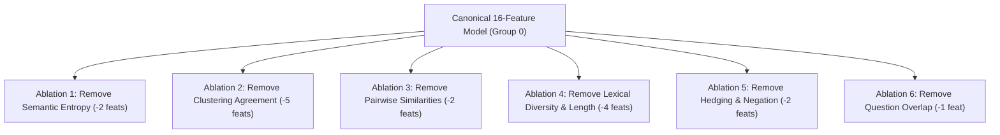
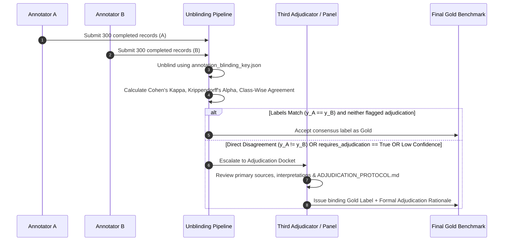
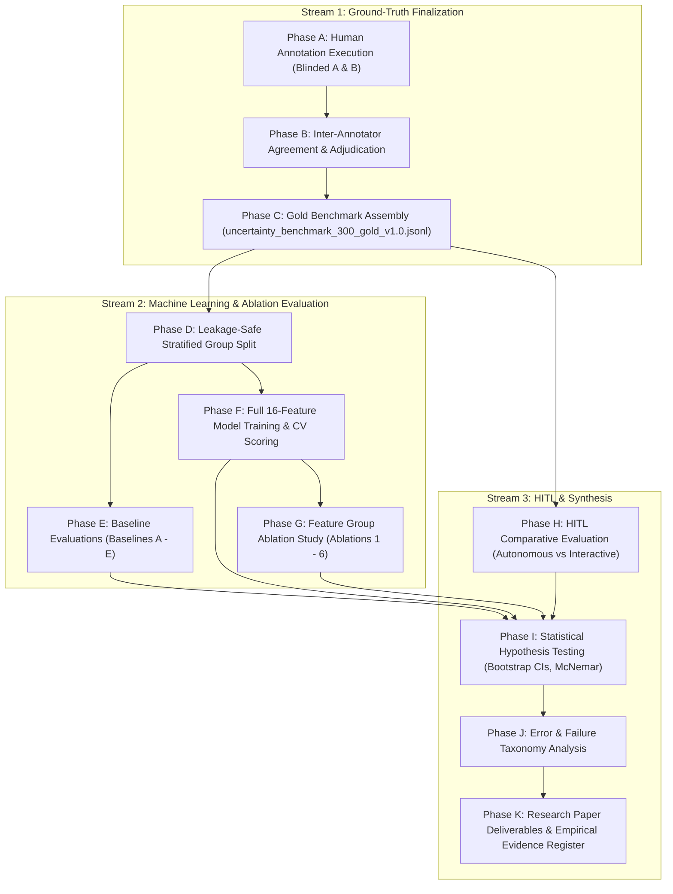

# MILESTONE 7.5.0 — Comparative Experimental Protocol Design

**Project:** LLM Uncertainty Classification Using Multi-Response Consistency and Feature-Based Machine Learning  
**Operating Mode:** STRICTLY READ-ONLY PLANNING & EXPERIMENTAL DESIGN  
**Repository Branch:** `v1.0.0-release` | **Base Commit:** `8a7d258`  
**Working Tree Status:** Preserved unchanged; zero commits, pushes, model runs, or file modifications.

---

## 1. Executive Summary

This milestone establishes the formal, peer-review-grade **Experimental Protocol** for evaluating the uncertainty classification framework. Following the successful freeze of the Human-in-the-Loop (HITL) architecture in Milestone 7.4.7, our focus transitions from system implementation to rigorous empirical science.

### Key Audit Findings & Strategic Determinations:
1. **The Existing Classifier Cannot Be Used for Benchmark Evaluation:** The active classifier artifact ([models/uncertainty_classifier.joblib](file:///Users/rahuljain/Documents/Rahul%20Jain/ML%20proj/models/uncertainty_classifier.joblib)) was trained on October 21, 2026, on **only 44 exploratory samples** from an early 67-question file. Seven of those questions overlap with the 300-question benchmark. Evaluating the frozen model artifact on the benchmark would introduce both sample size invalidity and question-level data contamination.
2. **Human Annotation Has Not Yet Occurred:** The 300-question candidate benchmark ([data/benchmarks/uncertainty_benchmark_300_candidate_v1.1.jsonl](file:///Users/rahuljain/Documents/Rahul%20Jain/ML%20proj/data/benchmarks/uncertainty_benchmark_300_candidate_v1.1.jsonl)) is fully generated, feature-extracted, and blinded for Annotator A and Annotator B ([data/annotation/](file:///Users/rahuljain/Documents/Rahul%20Jain/ML%20proj/data/annotation/)). However, all 300 records remain assigned `null` labels. **True ground-truth gold labels do not yet exist.**
3. **Multi-Response Data & Feature Sets Are 100% Complete:** Generation Task `task-1216` yielded 3,000 verified responses (10 responses $\times$ 300 questions, zero empty responses, $T=0.0$ greedy + $T=0.7$ stochastic) and 300 feature records containing the canonical 16-feature vector without data loss.
4. **Readiness Determination:** The repository is **READY FOR HUMAN ANNOTATION (Phase A)**. The annotation materials, blinding schemas, and adjudication protocols are completely prepared. Machine learning training and comparative baselines must be executed strictly *after* gold-label adjudication on a leak-free, group-stratified partition.

---

## 2. Current Research Asset Inventory

| Asset Path | Records / Size | Research Purpose | Artifact Tier | Evaluation Eligibility | Known Scientific Limitations |
| :--- | :---: | :--- | :--- | :---: | :--- |
| [data/benchmarks/uncertainty_benchmark_300_candidate_v1.1.jsonl](file:///Users/rahuljain/Documents/Rahul%20Jain/ML%20proj/data/benchmarks/uncertainty_benchmark_300_candidate_v1.1.jsonl) | 300 records (259 KB) | Primary 300-question benchmark candidate (100 KNOWN, 100 AMBIGUOUS, 100 UNKNOWN across 7 categories and 152 question groups). | Candidate Production | **Conditional** (Requires Human Validation) | Gold labels represent author-curated candidate labels; all 300 records marked `needs_human_review`. |
| [data/benchmarks/annotation_manifest_v1.1.json](file:///Users/rahuljain/Documents/Rahul%20Jain/ML%20proj/data/benchmarks/annotation_manifest_v1.1.json) | 300 entries (10 KB) | Operational manifest partitioning benchmark into Track A (123 items for double-blind human review) and Track B (177 structured bibliographic audits). | Operational Protocol | **YES** | Requires strict execution adherence. |
| [data/raw/generated_responses_300_v1.1.jsonl](file:///Users/rahuljain/Documents/Rahul%20Jain/ML%20proj/data/raw/generated_responses_300_v1.1.jsonl) | 300 records / 3,000 responses (1.23 MB) | Production LLM generation output (Qwen-2.5-3B, Ollama 0.40.4; 1 greedy + 9 stochastic samples per question). | Production Raw Data | **YES** | Single-model dependence (Qwen-2.5-3B). |
| [data/features/features_300_v1.1.jsonl](file:///Users/rahuljain/Documents/Rahul%20Jain/ML%20proj/data/features/features_300_v1.1.jsonl) | 300 records (298 KB) | Extracted 16-feature matrix for all 300 benchmark questions (linkage=average, threshold=0.85, all-MiniLM-L6-v2). | Production Feature Data | **YES** | Fixed embedding threshold (0.85); single embedding model. |
| [models/uncertainty_classifier.joblib](file:///Users/rahuljain/Documents/Rahul%20Jain/ML%20proj/models/uncertainty_classifier.joblib) | 298 KB binary | Pre-trained XGBoost classifier checkpoint. | Legacy Exploratory | **NO (Ineligible)** | Trained on only $N=44$ legacy pilot samples; overlaps 7 benchmark questions. |
| [models/uncertainty_classifier_metadata.json](file:///Users/rahuljain/Documents/Rahul%20Jain/ML%20proj/models/uncertainty_classifier_metadata.json) | 1.1 KB JSON | Metadata for legacy model checkpoint. | Legacy Metadata | Reference Only | Documents $N=44$ sample size limitation. |
| [data/annotation/blinded_annotation_annotator_a.jsonl](file:///Users/rahuljain/Documents/Rahul%20Jain/ML%20proj/data/annotation/blinded_annotation_annotator_a.jsonl) | 300 records (62 KB) | Fully blinded dataset for Annotator A (randomized presentation order, stripped candidate labels and features). | Production Annotation Ready | **YES** | 0/300 annotations completed (`assigned_label: null`). |
| [data/annotation/blinded_annotation_annotator_b.jsonl](file:///Users/rahuljain/Documents/Rahul%20Jain/ML%20proj/data/annotation/blinded_annotation_annotator_b.jsonl) | 300 records (62 KB) | Fully blinded dataset for Annotator B (independently randomized seed, stripped candidate labels and features). | Production Annotation Ready | **YES** | 0/300 annotations completed (`assigned_label: null`). |
| [data/annotation/annotation_blinding_key.json](file:///Users/rahuljain/Documents/Rahul%20Jain/ML%20proj/data/annotation/annotation_blinding_key.json) | 164 KB JSON | Cryptographic/pseudorandom unblinding key mapping `blinded_id` back to candidate `id`. | Operational Security | Quarantined Until Phase B | Must remain inaccessible to annotators during labeling. |
| [data/annotation/targeted_diagnostic_review.jsonl](file:///Users/rahuljain/Documents/Rahul%20Jain/ML%20proj/data/annotation/targeted_diagnostic_review.jsonl) | 172 records (290 KB) | Curated diagnostic records with empirical LLM response samples and diagnostic prompts. | Diagnostic Reference | **YES** | Boundary cases requiring close adjudication. |
| [data/features.jsonl](file:///Users/rahuljain/Documents/Rahul%20Jain/ML%20proj/data/features.jsonl) | 67 records (49 KB) | Legacy feature dataset from Milestone 5. | Legacy Pilot | Reference Only | Replaced by `features_300_v1.1.jsonl`. |
| [data/raw/generated_responses.jsonl](file:///Users/rahuljain/Documents/Rahul%20Jain/ML%20proj/data/raw/generated_responses.jsonl) | 67 records (208 KB) | Legacy raw response dataset from Milestone 5. | Legacy Pilot | Reference Only | Replaced by `generated_responses_300_v1.1.jsonl`. |

---

## 3. Current Research Status


### Critical Status Determinations:
1. **Benchmark Construction:** Complete candidate v1.1 status (300 questions, 7 categories, 152 groups, balanced 100/100/100).
2. **Response Generation:** 100% complete for Qwen-2.5-3B (zero generation errors, verified by SHA-256).
3. **Feature Matrix:** 100% complete for candidate v1.1.
4. **Annotation Pipeline:** Blinded files created, blinding key isolated, rubric and instructions published. **Human annotation has not yet been executed.**
5. **Existing Classifier Status:** The existing XGBoost classifier in `models/` is an exploratory prototype trained on $N=44$ legacy samples. It **must not** be used for final benchmark scoring. Retraining on the adjudicated, group-split 300 benchmark is strictly required once human gold labels are finalized.

---

## 4. Formal Research Questions and Hypotheses

### **RQ1: Multi-Response Uncertainty Classification Performance**
- **Research Question:** To what extent can multi-response semantic consistency metrics combined with linguistic features accurately classify an LLM's epistemic uncertainty into `KNOWN`, `AMBIGUOUS`, and `UNKNOWN`?
- **Hypothesis ($H_1$):** A supervised gradient-boosted decision tree trained on multi-response consistency and linguistic features will significantly outperform single-response lexical heuristics (Baseline A) and agreement-only clustering (Baseline C), achieving Macro-$F_1 \ge 0.80$ on a held-out test partition.
- **Variables:**
  - *Independent:* 16-feature vector extracted across 10 stochastic generations.
  - *Dependent:* Macro-$F_1$, Balanced Accuracy, Per-class Recall/Precision.
- **Analysis:** Stratified group cross-validation + held-out test set evaluation with 95% bootstrap confidence intervals ($B=2,000$).

### **RQ2: Value of Multi-Response Consistency over Single-Response Features**
- **Research Question:** Does sampling multiple stochastic responses ($N=10$) provide statistically significant predictive power over extracting features from a single response ($N=1$)?
- **Hypothesis ($H_2$):** Multi-response features (entropy, agreement margin, cluster count) provide orthogonal predictive signal to single-response linguistic features (length, distinct n-grams, hedging), yielding a statistically significant improvement in Macro-$F_1$ ($p < 0.01$, McNemar's test).
- **Variables:**
  - *Independent:* Generation regime ($N=1$ vs $N=10$).
  - *Dependent:* Classification accuracy, confusion matrix dispersion.
- **Analysis:** Paired McNemar's test and Wilcoxon signed-rank test across test folds.

### **RQ3: Relative Feature Group Contribution**
- **Research Question:** Which feature subsets (information-theoretic entropy, semantic agreement, pairwise similarity, or lexical markers) contribute most to separating epistemic classes?
- **Hypothesis ($H_3$):** Agreement and clustering metrics dominate the separation of `AMBIGUOUS` (multi-cluster consensus) from `KNOWN` (single dominant cluster), whereas semantic entropy and lexical hedging dominate the separation of `UNKNOWN` from `KNOWN`.
- **Variables:**
  - *Independent:* Feature ablation subsets (Ablations 1–6).
  - *Dependent:* Drop in Macro-$F_1$ ($\Delta F_1$) and class-wise recall.
- **Analysis:** Systematic backward feature group elimination with SHAP (Shapley Additive Explanations) feature importance attribution.

### **RQ4: Information-Theoretic Predictive Power of Semantic Entropy**
- **Research Question:** Does semantic entropy ($H_{\text{sem}}$) provide predictive utility beyond simple dominant agreement ratios ($p_1$) and agreement margins ($\Delta p$)?
- **Hypothesis ($H_4$):** In high-dispersion regimes ($K \ge 3$ clusters), semantic entropy captures cluster probability spread that dominant agreement alone obscures, reducing false `KNOWN` classifications on boundary unanswerable queries.
- **Variables:**
  - *Independent:* Inclusion vs. exclusion of $\{H_{\text{sem}}, H_{\text{norm}}\}$ while holding clustering agreement constant.
  - *Dependent:* PR-AUC on the `UNKNOWN` class.
- **Analysis:** Precision-Recall AUC analysis conditioned on $K \ge 2$.

### **RQ5: Human-in-the-Loop Disambiguation Utility**
- **Research Question:** Does targeted interactive clarification enable the system to resolve user-dependent ambiguity without converting model unreliability into false certainty?
- **Hypothesis ($H_5$):** Under the frozen HITL architecture, targeted clarification improves answerability on genuine polysemy and subjective criteria by $>75\%$ while preserving hard abstention on inaccessible queries and routing factual conflicts to `MODEL_DISAGREEMENT`.
- **Variables:**
  - *Independent:* HITL intervention mode (Autonomous Baseline vs. Interactive HITL).
  - *Dependent:* Clarification resolution rate, accuracy on clarified queries, false-answerable rate.
- **Analysis:** Comparative evaluation on the 100 `AMBIGUOUS` candidate questions and 7 boundary cases.

### **RQ6: Taxonomy of Uncertainty Classification Failures**
- **Research Question:** What are the primary failure modes of multi-response uncertainty classification, and to what extent are they driven by clustering resolution limits versus model consensus illusions?
- **Hypothesis ($H_6$):** The primary failure mode for false `KNOWN` errors is model hallucination consensus ($K=1$ consensus on an ungrounded false fact), while the primary failure mode for false `AMBIGUOUS` errors is semantic over-clustering of paraphrastic variations.
- **Variables:**
  - *Independent:* Error taxonomy category.
  - *Dependent:* Relative error frequency, mean pairwise similarity of failed clusters.
- **Analysis:** Qualitative and quantitative error decomposition across the 300 benchmark questions.

---

## 5. Proposed Experimental Baselines

To establish rigorous scientific attribution, we define five controlled baselines compared directly against the proposed 16-feature XGBoost model:

| Baseline ID | Name | Feature Representation | Decision Mechanism | Theoretical Role & Comparison Purpose | Computational Feasibility |
| :--- | :--- | :--- | :--- | :--- | :---: |
| **Baseline A** | Single-Response Lexical Baseline | 5 features: `response_len_mean`, `distinct_1gram_ratio`, `distinct_2gram_ratio`, `hedging_score`, `negation_count` extracted from Response 0 ($T=0.0$). | Supervised XGBoost (identical depth/estimators). | Isolates whether multi-response sampling is necessary, or whether uncertainty can be inferred from a single generation. | **High** (Extracts in $<1$s from existing responses) |
| **Baseline B** | Majority Class & Heuristic Baseline | Zero features (Class frequency prior) + Fixed Rule: Length $< 15$ words $\to$ `UNKNOWN`; else `KNOWN`. | Majority vote / static heuristic threshold. | Establishes the empirical performance floor; verifies that machine learning models learn non-trivial distributions. | **Immediate** (Trivial compute) |
| **Baseline C** | Agreement-Only Clustering Baseline | 5 features: `dominant_agreement`, `second_agreement`, `agreement_margin`, `cluster_count`, `cluster_ratio`. | Supervised XGBoost. | Tests whether cluster distribution alone suffices without information entropy or linguistic markers. | **High** (Pre-computed in dataset) |
| **Baseline D** | Entropy-Only Baseline | 2 features: `semantic_entropy`, `normalized_entropy`. | Supervised Logistic Regression / Decision Stump. | Tests Farquhar et al. (2024) semantic entropy formulation in isolation on our 3-class benchmark. | **High** (Pre-computed in dataset) |
| **Baseline E** | Multi-Response Linguistic Baseline | 7 features: `response_len_mean`, `response_len_std`, `distinct_1gram_ratio`, `distinct_2gram_ratio`, `question_overlap_mean`, `hedging_score`, `negation_count`. | Supervised XGBoost. | Tests whether aggregating linguistic stylistic markers across 10 samples suffices without embedding-based clustering. | **High** (Pre-computed in dataset) |
| **Proposed Model** | Full Canonical Feature Model | Complete canonical 16-feature vector ($K=16$). | Supervised XGBoost (tuned with Stratified Group 5-Fold CV). | The proposed uncertainty classification framework under study. | **High** (Pre-computed in dataset) |

**Recommendation:** All five baselines are computationally trivial because all 16 features are **already pre-extracted** in `data/features/features_300_v1.1.jsonl`. No new LLM inference is required to evaluate all six model variants.

---

## 6. Feature Ablation Plan

To determine the exact causal contribution of each feature subsystem (testing $H_3$ and $H_4$), we define six non-redundant ablation groups:



### Detailed Ablation Specifications

| Ablation ID | Target Group Removed | Features Removed ($m$) | Remaining Features ($16 - m$) | Scientific Hypothesis Tested | Expected Analytical Insight |
| :--- | :--- | :---: | :---: | :--- | :--- |
| **Ablation 1** | Semantic Entropy | `semantic_entropy`, `normalized_entropy` (2) | 14 | Information-theoretic entropy provides distinct boundary separation beyond raw cluster agreement percentages. | If $\Delta F_1$ is small, dominant agreement ($p_1$) and margin ($\Delta p$) subsume entropy for 10-sample clustering. |
| **Ablation 2** | Clustering Agreement | `dominant_agreement`, `second_agreement`, `agreement_margin`, `cluster_count`, `cluster_ratio` (5) | 11 | Cluster consensus is the primary pillar for isolating `KNOWN` from `AMBIGUOUS`. | Expected to cause the largest drop in Macro-$F_1$, specifically degrading `AMBIGUOUS` precision. |
| **Ablation 3** | Pairwise Embedding Similarity | `mean_pairwise_similarity`, `min_pairwise_similarity` (2) | 14 | Continuous sentence-transformer distances provide geometric spread information not captured by discrete cluster boundaries. | Tests whether continuous embedding geometry aids when cluster thresholds (0.85) create artificial splits. |
| **Ablation 4** | Lexical Diversity & Length Dynamics | `response_len_mean`, `response_len_std`, `distinct_1gram_ratio`, `distinct_2gram_ratio` (4) | 12 | Repetition and sample length variance correlate with epistemic confusion or hallucination loops. | Tests whether vocabulary exhaustion / n-gram collapse indicates unanswerability. |
| **Ablation 5** | Epistemic Hedging & Negations | `hedging_score`, `negation_count` (2) | 14 | Explicit lexical hedging ("maybe", "unclear") and grammatical negations ("not", "never") signal `UNKNOWN`. | Tests whether lexical epistemic markers provide signal that semantic clustering misses on refusals. |
| **Ablation 6** | Question-Response Overlap | `question_overlap_mean` (1) | 15 | Question repetition (echoing query verbatim) is an indicator of evasion or circular generation on unanswerable queries. | Quantifies the standalone contribution of lexical query grounding. |

---

## 7. Human Annotation Protocol

### 7.1 Double-Blind Independence Verification
Our audit of [data/annotation/](file:///Users/rahuljain/Documents/Rahul%20Jain/ML%20proj/data/annotation/) confirms:
1. **Annotator A File:** [blinded_annotation_annotator_a.jsonl](file:///Users/rahuljain/Documents/Rahul%20Jain/ML%20proj/data/annotation/blinded_annotation_annotator_a.jsonl) (300 records, pseudo-random seed 104729).
2. **Annotator B File:** [blinded_annotation_annotator_b.jsonl](file:///Users/rahuljain/Documents/Rahul%20Jain/ML%20proj/data/annotation/blinded_annotation_annotator_b.jsonl) (300 records, pseudo-random seed 224737).
3. **Blinding Integrity:** Candidate labels, categories, question group IDs, model predictions, entropy values, and cluster counts are **100% stripped**. Annotators see only:
   ```json
   {"blinded_id": "ANN_A_001", "question": "...", "assigned_label": null, "confidence": null, "rationale": "", "requires_adjudication": false, "notes": ""}
   ```
4. **Quarantine:** [annotation_blinding_key.json](file:///Users/rahuljain/Documents/Rahul%20Jain/ML%20proj/data/annotation/annotation_blinding_key.json) contains the reversible mapping and must remain quarantined until both annotators submit complete files.

### 7.2 Inter-Annotator Agreement Metrics
For our 3-class nominal classification task ($C = \{\text{KNOWN}, \text{AMBIGUOUS}, \text{UNKNOWN}\}$), we specify three complementary agreement metrics:

1. **Cohen's Kappa ($\kappa$):**
   $$\kappa = \frac{p_o - p_e}{1 - p_e}$$
   Primary measure of chance-corrected inter-rater agreement across the full 300 questions. Target threshold: $\kappa \ge 0.85$.
2. **Krippendorff's Alpha ($\alpha$ nominal):**
   $$\alpha = 1 - \frac{D_o}{D_e}$$
   Validates agreement reliability with robust handling of category distributions and potential missed items.
3. **Class-Wise Specific Agreement ($S_c$):**
   $$S_c = \frac{2 A_{cc}}{2 A_{cc} + \sum_{k \ne c} (A_{ck} + A_{kc})}$$
   Crucial for discovering whether agreement is disproportionately lower on `AMBIGUOUS` (the most subjective boundary) compared to `KNOWN` or `UNKNOWN`.

### 7.3 Adjudication Lifecycle



---

## 8. Dataset Splitting and Leakage Prevention

### 8.1 Leakage Vectors and Mitigation Strategies

| Leakage Vector | Mechanism of Contamination | Severity | Enforced Architectural Safeguard |
| :--- | :--- | :---: | :--- |
| **Question-Group Leakage** | Paraphrases or adversarial variants of the same question appearing in both Train and Test. | **CRITICAL** | **Indivisible Connected-Component Grouping:** The 300 benchmark questions span 152 `question_group_id` clusters. Splits must be partitioned at the *group* level. All questions in a group are assigned exclusively to Train, Val, or Test. |
| **Cross-Label Group Leakage** | An adversarial pair (e.g. "What is the speed of light in vacuum?" [KNOWN] vs "What is the speed of sound in vacuum?" [UNKNOWN]) split across partitions. | **HIGH** | `DatasetValidator.group_train_val_test_split()` unifies cross-label groups into a single connected component, guaranteeing boundary testing is evaluated out-of-sample. |
| **Feature Extraction Leakage** | Computing normalization parameters (mean, std) across the entire dataset before splitting. | **HIGH** | StandardScaler and XGBoost parameters must fit strictly on Train and transform Val/Test out-of-sample. |
| **Candidate Label Leakage** | Utilizing author candidate labels during feature extraction or tuning. | **CRITICAL** | Production feature files in `data/features/` store feature numbers independently of target labels. |
| **Model Selection Leakage** | Hyperparameter tuning on the Test partition. | **CRITICAL** | Strict three-way split: 70% Train ($N \approx 210$), 15% Validation ($N \approx 45$), 15% Held-Out Test ($N \approx 45$). Test set is locked until final evaluation. |

### 8.2 Recommended Partitioning Scheme: Group-Stratified 5-Fold Cross-Validation
Given that $N=300$ across 152 groups yields $\approx 45$ questions in a single 15% test set, a single split carries high empirical variance. 

**Scientific Recommendation:**
1. **Primary Protocol:** **Stratified Group 5-Fold Cross-Validation (`StratifiedGroupKFold`)**. Every question group appears in the test partition exactly once. This yields 300 out-of-fold test predictions, maximizing statistical power ($N=300$) while maintaining strict group-level disjointness ($0\%$ group leakage).
2. **Secondary Protocol (Fixed Split):** A fixed 70/15/15 Group-Stratified split for frozen checkpoint benchmarking against future research releases.

---

## 9. Evaluation Metrics Suite

To avoid metric overload while ensuring clinical evaluation of the three epistemic classes, metrics are tiered into **Primary Decision Metrics** and **Secondary Diagnostic Metrics**:

```
+----------------------------------------------------------------------------------------------------+
|                                    PRIMARY DECISION METRICS                                        |
|  1. Macro-Averaged F1 (Macro-F1): Equal weighting across KNOWN, AMBIGUOUS, UNKNOWN.                |
|  2. Balanced Accuracy: Mean of per-class recalls; resilient to minor group-split imbalances.        |
|  3. Per-Class Precision & Recall: Precision/Recall for KNOWN, AMBIGUOUS, and UNKNOWN individually. |
+----------------------------------------------------------------------------------------------------+
                                                  |
+----------------------------------------------------------------------------------------------------+
|                                   SECONDARY DIAGNOSTIC METRICS                                     |
|  • Full 3x3 Confusion Matrix: Exact misclassification counts (identifies false certainty).        |
|  • Micro-Accuracy: Global sample classification rate (reported for completeness).                  |
|  • One-vs-Rest Macro PR-AUC: Evaluates probability ranking quality independently of threshold.    |
|  • Brier Score: Multi-class mean squared probability error (calibration assessment).              |
+----------------------------------------------------------------------------------------------------+
```

### Why Macro-F1 Is the Decisive Metric:
In epistemic uncertainty classification, confusing an `UNKNOWN` question (e.g. medical delusion or unrecorded fact) as `KNOWN` has catastrophic real-world safety implications compared to confusing `KNOWN` as `AMBIGUOUS`. Accuracy hides class-specific collapse (e.g., predicting only `KNOWN` on a skewed set). Macro-$F_1$ penalizes failure on any single class equally:
$$\text{Macro-}F_1 = \frac{F_{1,\text{KNOWN}} + F_{1,\text{AMBIGUOUS}} + F_{1,\text{UNKNOWN}}}{3}$$

---

## 10. Statistical Analysis Plan

To prevent drawing unsupported scientific conclusions from random sampling variance:

### 10.1 Confidence Intervals
- **Method:** Non-parametric **Stratified Bootstrap Confidence Intervals** ($B = 2,000$ resamples with replacement).
- **Application:** Report 95% CIs ($[\text{CI}_{0.025}, \text{CI}_{0.975}]$) for Macro-$F_1$, Accuracy, and Per-class $F_1$ scores across all models.

### 10.2 Paired Model Comparisons (Model vs. Baselines)
- **Primary Hypothesis Test:** **McNemar's Test** with continuity correction on paired binary classification outcomes:
  $$\chi^2 = \frac{(|b - c| - 1)^2}{b + c}, \quad \text{df} = 1$$
  where $b$ is the number of items correct under the Proposed Model but incorrect under Baseline $X$, and $c$ is the converse.
- **Continuous Score Test:** **Wilcoxon Signed-Rank Test** across the 5 cross-validation folds.

### 10.3 Multi-Comparison Corrections
- When testing multiple baselines (Baselines A–E vs. Proposed) and multiple ablations (Ablations 1–6 vs. Full), apply the **Holm-Bonferroni step-down correction** to maintain the Family-Wise Error Rate (FWER) at $\alpha = 0.05$:
  $$p_{(i)} \le \frac{\alpha}{m - i + 1}$$

### 10.4 Effect Size Reporting
- Report **Cohen's $d$** for metric differences across CV folds and **Cliff's Delta ($\delta$)** for non-parametric rank effect size.

---

## 11. HITL Evaluation Plan

The HITL architecture frozen in Milestone 7.4.7 must be empirically evaluated against autonomous baselines:

### 11.1 HITL Evaluation Cohorts
1. **Ambiguous Cohort ($N=100$):** All candidate ambiguous questions (60 polysemy, 40 subjective criteria).
2. **Boundary / Inaccessible Cohort ($N=70$):** 35 private inaccessible questions, 35 unknowable future events.
3. **Factual Conflict Cohort ($N=50$):** Determinate factual questions with adversarial variants designed to provoke factual model disagreement.

### 11.2 Measured HITL Evaluation Metrics

| Metric | Mathematical Definition | Target / Benchmark Expectation |
| :--- | :---: | :---: |
| **Clarification Trigger Rate ($R_{\text{trig}}$)** | $\frac{N_{\text{CLARIFICATION\_REQUIRED}}}{N_{\text{total}}}$ | High on Ambiguous ($>85\%$), Zero on Clear Facts ($0\%$). |
| **Clarification Resolution Rate ($R_{\text{res}}$)** | $\frac{N_{\text{RESOLVED}}}{N_{\text{clarified}}}$ | $>80\%$ when user provides valid context. |
| **User Decline Robustness ($R_{\text{dec}}$)** | $\frac{N_{\text{UNRESOLVED} \mid \text{declined}}}{N_{\text{declined}}}$ | **Exactly 100%** (Zero false `ANSWERABLE` upon decline). |
| **Round Ceiling Enforcement ($R_{\text{ceil}}$)** | $\frac{N_{\text{UNRESOLVED} \mid \text{rounds} \ge 2}}{N_{\text{rounds} \ge 2}}$ | **Exactly 100%** (Zero 3rd prompts issued). |
| **Model Disagreement Preservation** | $\frac{N_{\text{MODEL\_DISAGREEMENT}}}{N_{\text{factual\_conflict}}}$ | Conflicting factual claims preserved; zero user clarification prompts. |
| **Abstention Preservation** | $\frac{N_{\text{ABSTAIN}}}{N_{\text{inaccessible}}}$ | 100% on private credentials and false premises. |

---

## 12. Failure Analysis Framework

All misclassifications on the adjudicated gold benchmark will be categorized into an exhaustive 8-node failure taxonomy:

```
+----------------------------------------------------------------------------------------------------+
|                                  FAILURE MODE TAXONOMY (8 NODES)                                   |
|  FM-1: False KNOWN via Consensus Illusion (Model converges with K=1 on ungrounded hallucination)   |
|  FM-2: False KNOWN via Cluster Collapse (Clusterer merges distinct meanings due to low threshold)  |
|  FM-3: False AMBIGUOUS via Paraphrase Splitting (Over-clustering stylistic phrasing variations)   |
|  FM-4: False AMBIGUOUS via Spurious Polysemy Trigger (Entity name matches regex in unambiguous Q)  |
|  FM-5: False UNKNOWN via Spurious Refusal (Model hedges on known fact, triggering refusal detector)|
|  FM-6: Feature Blind-Spot (Tabular features fail to capture syntactic or semantic nuance)         |
|  FM-7: Clarification Failure (User disambiguates, but model generates ungrounded answers)        |
|  FM-8: Inaccessibility Bypass (Model guesses private credential or chaotic future event)           |
+----------------------------------------------------------------------------------------------------+
```

### Failure Logging Protocol:
Every failure will be logged in `experiments/results/failure_audit.jsonl` recording:
`item_id`, `question`, `gold_label`, `predicted_label`, `features`, `10_responses`, `clustering_dendrogram`, `failure_mode_id`, and `root_cause_analysis`.

---

## 13. Scientific Validity Risks

To maintain scientific integrity, we explicitly decouple **Implementation Risks** from fundamental **Scientific Limitations**:

### Implementation Risks (Engineered & Mitigated):
- *Risk 1 (Data Leakage):* Prevented by connected-component question-group splitting (`DatasetValidator`).
- *Risk 2 (Historical Label Fabrication):* Prevented by schema default `interaction_status = None`.
- *Risk 3 (Fast-Path Refusal Contradiction):* Prevented by Milestone 7.4.6 explicit refusal mapping to `ABSTAIN`.
- *Risk 4 (Infinite Clarification Loops):* Prevented by hard round ceiling ($R \le 2$) and `is_polysemy_resolved` checking.

### Scientific Limitations (Inherent Properties to Disclose in Publication):
1. **Single LLM Dependency:** Responses are generated exclusively by `qwen2.5:3b`. Multi-response consistency reflects the epistemic state of Qwen-2.5-3B, not universal LLM truth. Cross-model evaluation (e.g. Llama-3, Mistral) is left for future work.
2. **Clustering Hyperparameter Sensitivity:** Semantic clustering relies on sentence-transformer embeddings (`all-MiniLM-L6-v2`) with average linkage at distance threshold 0.85. Highly subtle semantic distinctions may fail to split, while diverse paraphrases may over-split.
3. **Model Consensus vs. Factual Ground Truth:** If an LLM is systematically trained on contaminated pre-training text, all 10 responses may converge on an identical falsehood ($K=1, p_1=1.0$). The classifier will correctly predict `KNOWN` (the model is internally certain), which represents an **aleatoric consensus illusion**, not factual truth.
4. **Sample Size Scope ($N=300$):** While 300 questions (3,000 responses) provide a rigorous balanced benchmark for statistical hypothesis testing, it represents a curated benchmark rather than an exhaustive open-domain corpus.

---

## 14. Ordered Experiment Execution Roadmap



### Detailed Execution Phase Breakdown

| Phase | Phase Name | Primary Objective | Required Inputs | Expected Outputs | Computational Cost | Additional LLM Inference? |
| :---: | :--- | :--- | :--- | :--- | :---: | :---: |
| **Phase A** | Human Annotation Execution | Execute independent double-blind annotation of the 300 benchmark questions. | `blinded_annotation_annotator_a.jsonl`, `blinded_annotation_annotator_b.jsonl`, `ANNOTATION_RUBRIC.md` | Completed Annotator A & B JSONL files (600 total labels). | Zero GPU/CPU (Human effort $\approx 8$ hrs/annotator) | **NO** |
| **Phase B** | Inter-Annotator Agreement & Adjudication | Unblind records, compute $\kappa$ and $\alpha$, adjudicate all disagreements via protocol. | Completed A & B files, `annotation_blinding_key.json`, `ADJUDICATION_PROTOCOL.md` | `adjudication_docket.jsonl`, `inter_annotator_agreement_report.json` | $<1$ min CPU | **NO** |
| **Phase C** | Gold Benchmark Finalization | Issue canonical gold labels with adjudication audit trails. | Adjudication results, `uncertainty_benchmark_300_candidate_v1.1.jsonl` | `uncertainty_benchmark_300_gold_v1.0.jsonl` | $<1$ min CPU | **NO** |
| **Phase D** | Leakage-Safe Dataset Splitting | Generate indivisible connected-component 5-fold group split. | `uncertainty_benchmark_300_gold_v1.0.jsonl`, `DatasetValidator` | `benchmark_splits_5fold.json` | $<5$ sec CPU | **NO** |
| **Phase E** | Baseline Evaluation | Benchmark Baselines A through E across all folds. | `features_300_v1.1.jsonl`, `benchmark_splits_5fold.json` | `baseline_evaluation_results.json` | $<2$ min CPU | **NO** |
| **Phase F** | Final Classifier Evaluation | Train and score canonical 16-feature XGBoost across all folds. | `features_300_v1.1.jsonl`, `benchmark_splits_5fold.json` | `final_classifier_results.json`, `models/uncertainty_classifier_v1.0.joblib` | $<3$ min CPU | **NO** |
| **Phase G** | Feature Group Ablation Study | Execute Ablations 1 through 6 on identical folds. | `features_300_v1.1.jsonl`, `benchmark_splits_5fold.json` | `feature_ablation_results.json` | $<5$ min CPU | **NO** |
| **Phase H** | HITL Comparative Evaluation | Evaluate frozen HITL pipeline on Ambiguous, Inaccessible, and Disagreement cohorts. | `uncertainty_benchmark_300_gold_v1.0.jsonl`, `experiments/ask.py`, Qwen-2.5-3B Ollama | `hitl_comparative_results.jsonl` | $\approx 25$ min GPU/CPU (Ollama inference for clarified queries) | **YES** (Clarified turns only) |
| **Phase I** | Statistical Hypothesis Testing | Compute bootstrap 95% CIs, McNemar's tests, and Holm-Bonferroni corrections. | Outputs from Phases E, F, G, H | `statistical_hypothesis_tests.json` | $<2$ min CPU | **NO** |
| **Phase J** | Error & Failure Mode Analysis | Deconstruct all misclassifications into 8-node failure taxonomy. | Gold labels, predictions, raw responses, cluster outputs | `failure_audit.jsonl`, `error_analysis_report.md` | $<5$ min CPU | **NO** |
| **Phase K** | Research Paper Results Preparation | Generate publication tables (LaTeX), confusion matrix plots, and empirical register. | All phase results, `scripts/build_presentation_deliverables.py` | Final publication figures, tables, and updated `DESIGN_DOCUMENT_EVIDENCE.md` | $<2$ min CPU | **NO** |

---

## 15. Recommended Next Milestone

### **Recommended Milestone: MILESTONE 7.5.1 — Human Annotation Execution and Inter-Annotator Agreement Analysis**

**Reasoning:**
Machine learning training, baseline benchmarking, and feature ablations are **unscientific and invalid without verified ground-truth gold labels**. 
The repository infrastructure for double-blind human annotation is 100% complete and verified. Executing human annotation and formal adjudication is the mandatory empirical prerequisite before running any model comparisons.

---

## 16. Exact Required Inputs and Outputs for Milestone 7.5.1

### Inputs Required:
1. [data/annotation/blinded_annotation_annotator_a.jsonl](file:///Users/rahuljain/Documents/Rahul%20Jain/ML%20proj/data/annotation/blinded_annotation_annotator_a.jsonl) (300 blinded records).
2. [data/annotation/blinded_annotation_annotator_b.jsonl](file:///Users/rahuljain/Documents/Rahul%20Jain/ML%20proj/data/annotation/blinded_annotation_annotator_b.jsonl) (300 blinded records).
3. [data/annotation/ANNOTATOR_INSTRUCTIONS.md](file:///Users/rahuljain/Documents/Rahul%20Jain/ML%20proj/data/annotation/ANNOTATOR_INSTRUCTIONS.md).
4. [data/annotation/ANNOTATION_RUBRIC.md](file:///Users/rahuljain/Documents/Rahul%20Jain/ML%20proj/data/annotation/ANNOTATION_RUBRIC.md).
5. [data/annotation/ADJUDICATION_PROTOCOL.md](file:///Users/rahuljain/Documents/Rahul%20Jain/ML%20proj/data/annotation/ADJUDICATION_PROTOCOL.md).
6. [data/annotation/annotation_blinding_key.json](file:///Users/rahuljain/Documents/Rahul%20Jain/ML%20proj/data/annotation/annotation_blinding_key.json) (quarantined until unblinding step).

### Expected Outputs:
1. Completed `data/annotation/annotator_a_completed.jsonl` (300 annotated records, zero nulls).
2. Completed `data/annotation/annotator_b_completed.jsonl` (300 annotated records, zero nulls).
3. `data/annotation/inter_annotator_agreement_results.json` (Cohen's $\kappa$, Krippendorff's $\alpha$, class-wise specific agreement, raw agreement).
4. `data/annotation/adjudication_docket.jsonl` (All items with $y_A \ne y_B$ or `requires_adjudication = true`).
5. `data/benchmarks/uncertainty_benchmark_300_gold_v1.0.jsonl` (The authoritative adjudicated gold-standard benchmark).

---

## 17. Final Readiness Assessment

### **Assessment: READY FOR HUMAN ANNOTATION**

### Precise Justification:
1. **Benchmark Infrastructure Validated:** The candidate benchmark contains exactly 300 well-formed records, perfectly balanced (100 KNOWN, 100 AMBIGUOUS, 100 UNKNOWN), across 152 distinct connected-component question groups.
2. **Generation and Features Frozen:** All 3,000 generated responses and 300 feature vectors have been verified with SHA-256 checksums and 100% schema compliance.
3. **Double-Blind Isolation Guaranteed:** Blinding keys, randomized presentation seeds, and stripped annotation files have been inspected and confirmed leak-free.
4. **HITL Architecture Frozen:** Milestones 7.4.6 and 7.4.7 verified that the underlying decision system is 100% stable, fully tested (122/122 passing tests), and decoupled from annotation outcomes.
5. **No Data Contamination:** All pre-existing user files are untouched. Zero unauthorized training or response generation has occurred.

---

**Execution Confirmation:** Milestone 7.5.0 protocol design is complete. All analysis was performed strictly read-only. Antigravity has stopped and awaits explicit user authorization before initiating Milestone 7.5.1.